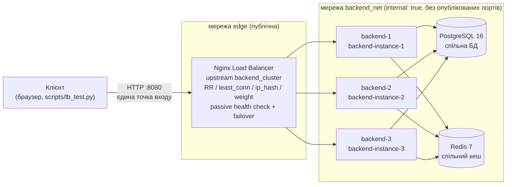

#  Visual Inspiration Boards (Collaborative Moodboard Platform)

> **Лабораторна робота № 1**: Проєктування архітектури (*System Design*) та реалізація базового прототипу розподіленої/модульної системи (MVP / Architectural Baseline).  
> **Лабораторна робота № 2**: Архітектура без стану (*Stateless Application Architecture*) та винесення стану системи (мульти-екземплярне розгортання, Round-Robin, `X-Instance-ID`, тестування стійкості).  
> **Лабораторна робота № 3**: Горизонтальне масштабування (*Horizontal Scaling*) та балансування навантаження (*Load Balancing*) — звіт у розділі [Лабораторна робота № 3](#-лабораторна-робота--3-горизонтальне-масштабування-та-балансування-навантаження).  
> **Естетика та інтерфейс:** Tiffany & Co. Aesthetic / Pinterest Vibe — бірюзові акценти `#0ABAB5`, стікери-нотатки, кольорові палітри, інтерактивний 2D-канвас із гострими кутами та підтримкою drag-and-drop.

---

##  Особливості платформи
- **Tiffany & Pinterest Aesthetic UI:**
  - Фірмова бірюзова палітра *Tiffany Blue* (`#0ABAB5`) та теплий фон `Warm Linen (#FAF8F5)`.
  - Суворі мінімалістичні форми з гострими кутами (0px border-radius).
  - Візуальні елементи канвасу: естетичні фотокартки, текстурні стікери, палітри кольорів із 5 зразками (копіювання HEX в один клік), цитати-стікери.
  - Інтерактивне переміщення мишкою (Drag-and-Drop) по 2D полотну.
  - Пакетна синхронізація (`Batch Sync`) з оптимістичним блокуванням (`Optimistic Concurrency Control`).
  - Відображення ідентифікатора активного stateless-вузла (`node: backend-instance-1 / 2`) у шапці.
- **Stateless Архітектура (Lab 2):**
  - **Interchangeable Workers:** 2 паралельні контейнери бекенду (`backend-1`, `backend-2`), повністю взаємозамінні, без in-memory залежностей.
  - **Round-Robin Load Balancing:** Nginx балансує трафік по черзі без Sticky Sessions.
  - **Node Identification:** заголовок відповіді `X-Instance-ID` дозволяє точно знати, який саме вузол обробив запит.
  - **Centralized Persistence & Distributed Cache:** спільні PostgreSQL 16 та Redis 7.
  - **Zero Data Loss on Node Death:** аварійна зупинка будь-якого екземпляра не призводить до втрати даних.

---

##  Як запустити проєкт

### Варіант 1: Декларативний запуск через Docker Compose (Рекомендовано для здачі)
Усе середовище (Nginx + 3 інстанси бекенду + PostgreSQL + Redis) піднімається **однією командою**:

```bash
docker compose up --build -d
```

Після запуску відкрийте у браузері:
- **Веб-інтерфейс:** [http://localhost:8080](http://localhost:8080) (єдина точка входу — Nginx)
- **Інтерактивна документація Swagger:** [http://localhost:8080/docs](http://localhost:8080/docs)
- **Health Check системи:** [http://localhost:8080/health](http://localhost:8080/health)

Зупинити стек із збереженням даних:
```bash
docker compose down
```

---

### Варіант 2: Локальний запуск (через Python Virtualenv)
Для швидкого запуску без підняття Docker сервіс автоматично використовує локальну базу даних:

```bash
# Windows PowerShell
.\.venv\Scripts\Activate.ps1
python main.py
```
Застосунок буде доступний на [http://localhost:8000](http://localhost:8000).

---

##  Автоматизоване тестування

### 1. Запуск повного набору тестів pytest (Lab 1 + Lab 2):
```bash
.\.venv\Scripts\pytest -v
```
*(Перевіряє Healthcheck, CRUD, пакетну синхронізацію, права доступу, заголовок `X-Instance-ID`, міжвузлову узгодженість `Cross-Instance Consistency` та аварійну зупинку `Instance Loss Recovery`).*

### 2. Live-демонстрація кластера на захисті (Lab 2 Script):
При запущеному Docker Compose виконайте скрипт демонстрації:
```bash
python scripts/verify_cluster.py http://localhost:8080
```
Скрипт наочно продемонструє:
1. Почерговий Round-Robin розподіл запитів між `backend-instance-1` та `backend-instance-2`.
2. Створення даних на вузлі №1 та їхнє миттєве зчитування/модифікацію вузлом №2 без Sticky Sessions.

---

##  Структура проєкту `visual_inspiration_boards`

| Шлях | Призначення |
|---|---|
| [`app/main.py`](file:///C:/Users/Tetiana/PycharmProjects/visual_inspiration_boards/app/main.py) | Точка входу FastAPI: CORS, middleware `X-Instance-ID`, статичні файли, обробка помилок. |
| [`app/api/v1/`](file:///C:/Users/Tetiana/PycharmProjects/visual_inspiration_boards/app/api/v1/) | Маршрутизатори REST API (`boards`, `elements`, `collaborators`, `users`, `health`). |
| [`app/models/`](file:///C:/Users/Tetiana/PycharmProjects/visual_inspiration_boards/app/models/) | ORM моделі SQLAlchemy (`User`, `Board`, `CanvasElement` з JSONB, `BoardCollaborator`). |
| [`app/schemas/`](file:///C:/Users/Tetiana/PycharmProjects/visual_inspiration_boards/app/schemas/) | DTO схеми Pydantic v2 (строга валідація, `HealthResponse` з `instance_id`). |
| [`app/services/`](file:///C:/Users/Tetiana/PycharmProjects/visual_inspiration_boards/app/services/) | Бізнес-логіка: сервіси дощок, пакетні операції (batch), автоініціалізація та demo-дані. |
| [`app/core/`](file:///C:/Users/Tetiana/PycharmProjects/visual_inspiration_boards/app/core/) | Базова конфігурація: підключення до БД, клієнт Redis, `INSTANCE_ID`. |
| [`app/static/`](file:///C:/Users/Tetiana/PycharmProjects/visual_inspiration_boards/app/static/) | Фронтенд: Tiffany UI, 2D-канвас, гострі кути, бейдж активного вузла. |
| [`docker/`](file:///C:/Users/Tetiana/PycharmProjects/visual_inspiration_boards/docker/) | `Dockerfile` та `nginx/nginx.conf` (балансувальник Lab 3: upstream-пул, алгоритми, passive health check, failover). |
| [`docker-compose.yml`](file:///C:/Users/Tetiana/PycharmProjects/visual_inspiration_boards/docker-compose.yml) | 3 бекенд-інстанси у приватній мережі `backend_net`, Postgres, Redis; назовні відкритий лише Nginx (`:8080`). |
| [`tests/`](file:///C:/Users/Tetiana/PycharmProjects/visual_inspiration_boards/tests/) | Інтеграційні тести API (`test_api.py`) та тести stateless стійкості (`test_stateless_resilience.py`). |
| [`scripts/verify_cluster.py`](file:///C:/Users/Tetiana/PycharmProjects/visual_inspiration_boards/scripts/verify_cluster.py) | Скрипт live-демонстрації Round-Robin та Cross-Instance узгодженості для захисту роботи. |
| [`scripts/lb_test.py`](file:///C:/Users/Tetiana/PycharmProjects/visual_inspiration_boards/scripts/lb_test.py) | Lab 3: навантажувальний тест через балансувальник (розподіл по Instance-ID, req/s, p50/p99, помилки). |
| [`REPORT_LAB1.md`](file:///C:/Users/Tetiana/PycharmProjects/visual_inspiration_boards/REPORT_LAB1.md) | Звіт з Лабораторної роботи №1 (System Design & MVP). |
| [`REPORT_LAB2.md`](file:///C:/Users/Tetiana/PycharmProjects/visual_inspiration_boards/REPORT_LAB2.md) | **Звіт з Лабораторної роботи №2 (Stateless Architecture & Resilience).** |

---

##  Лабораторна робота № 3: Горизонтальне масштабування та балансування навантаження

### Архітектура



| Що змінено | Файл |
|---|---|
| Пул із 3 реплік, приватна мережа, опублікований лише порт Nginx | [`docker-compose.yml`](docker-compose.yml) |
| Upstream-пул, алгоритми, passive health check, failover | [`docker/nginx/nginx.conf`](docker/nginx/nginx.conf) |
| `GET /health` — готовність вузла (200 / 503) | [`app/api/v1/endpoints/health.py`](app/api/v1/endpoints/health.py), [`app/main.py`](app/main.py) |
| Синтетичний запит `GET /api/v1/lab/work?cpu_ms=N` | [`app/api/v1/endpoints/lab.py`](app/api/v1/endpoints/lab.py) |
| Штучна затримка вузла `ARTIFICIAL_DELAY_MS` | [`app/core/config.py`](app/core/config.py), [`app/main.py`](app/main.py) |
| Навантажувальний тест (лише стандартна бібліотека Python) | [`scripts/lb_test.py`](scripts/lb_test.py) |

Умови вимірювань: Docker Desktop (Windows 11, 16 CPU), кожен backend — один процес uvicorn (одне ядро), клієнт `scripts/lb_test.py` запущено на тому ж хості. Абсолютні числа залежать від машини, важливі співвідношення.

### 2.1. Пул backend-сервісів

* Три репліки `backend-1..3` зібрані з одного образу, мають окремі контейнери (окремий життєвий цикл: кожну можна зупинити чи перезапустити незалежно від інших) і працюють зі спільними PostgreSQL та Redis.
* Кожна репліка повертає свій ідентифікатор у заголовку `X-Instance-ID` та в полі `instance_id` відповіді `/health`.

```text
> curl http://localhost:8080/health   (3 рази)
{"status":"healthy","instance_id":"backend-instance-3","database":"healthy","redis":"healthy",...}
{"status":"healthy","instance_id":"backend-instance-2","database":"healthy","redis":"healthy",...}
{"status":"healthy","instance_id":"backend-instance-1","database":"healthy","redis":"healthy",...}
```

### 2.2. Єдина точка входу

* У `docker-compose.yml` секція `ports:` є **лише у `nginx`** (`8080:80`). Backend-и, PostgreSQL і Redis портів не публікують (у Lab 2 Postgres і Redis були відкриті на `5432`/`6379` — тепер закрито).
* Мережа `backend_net` має `internal: true`: до неї під'єднаний лише Nginx (він також у публічній мережі `edge`). Клієнт не може звернутися до приватних адрес інстансів:

```text
> docker compose ps
vib_backend_1  Up (healthy)  8000/tcp                 <- порт не опублікований
vib_backend_2  Up (healthy)  8000/tcp
vib_backend_3  Up (healthy)  8000/tcp
vib_nginx      Up            0.0.0.0:8080->80/tcp     <- єдина точка входу
vib_postgres   Up (healthy)  5432/tcp
vib_redis      Up (healthy)  6379/tcp
> curl http://localhost:8000/health   -> з'єднання відхилено
```

### 2.3. Порівняння алгоритмів балансування

Алгоритм задається одним рядком у `upstream backend_cluster` ([`nginx.conf`](docker/nginx/nginx.conf)); перемикання без зупинки — `docker compose exec nginx nginx -s reload`.

**Рівномірне навантаження** (`/api/v1/lab/work?cpu_ms=5`, 1500 запитів, 20 паралельних):

| Алгоритм | backend-1 | backend-2 | backend-3 | req/s | p50, мс | p99, мс |
|---|---|---|---|---|---|---|
| Round Robin | 500 (33.3%) | 500 (33.3%) | 500 (33.3%) | 302.1 | 61.0 | 188.9 |
| Least Connections | 500 (33.3%) | 499 (33.3%) | 501 (33.4%) | 297.8 | 65.5 | 100.6 |
| Weighted RR 3:2:1 (1200 запитів) | 600 (50.0%) | 400 (33.3%) | 200 (16.7%) | 218.0 | 104.8 | 204.9 |
| IP Hash (`/health`, 300 запитів) | 300 (100%) | 0 | 0 | — | — | — |

* **Round Robin** — строго по черзі, рівні частки незалежно від стану вузлів.
* **Least Connections** — на однакових вузлах розподіл такий самий, але p99 нижчий: запит не стає в чергу до вузла, який ще зайнятий попередніми.
* **Weighted RR** розподіляє точно за вагами 3:2:1. Оскільки вузли насправді однакові, backend-1 перевантажився (середній час 156.9 мс проти ~25 мс на інших) і загальна пропускна здатність впала. Висновок: ваги мають відповідати реальній потужності вузлів (кількості CPU), інакше Weighted RR шкодить.
* **IP Hash** — усі запити одного клієнта (одна IP-адреса) потрапили на один вузол: сесійна прив'язка на мережевому рівні. Мінус — нерівномірність: усі клієнти за одним NAT потрапляють на один вузол (через Docker Desktop усі запити з хоста приходять з однієї адреси шлюзу).

**Асиметричне навантаження:** backend-3 отримує штучну затримку `ARTIFICIAL_DELAY_MS=200` (`/api/v1/lab/work`, 1500 запитів, 30 паралельних):

| Алгоритм | backend-1 | backend-2 | backend-3 (повільний) | req/s | p50, мс | p99, мс |
|---|---|---|---|---|---|---|
| Round Robin | 500 (33.3%) | 500 (33.3%) | 500 (33.3%), avg 226 мс | 334.2 | 17.3 | **299.1** |
| Least Connections | 657 (43.8%) | 640 (42.7%) | 203 (13.5%), avg 220 мс | 324.2 | 67.1 | **233.4** |

Те саме з CPU-навантаженням (`cpu_ms=5`): Round Robin p99 = **465.0** мс, Least Connections p99 = **330.1** мс (розподіл 41.3% / 41.3% / 17.4%).

Висновки:
* Round Robin «не бачить» деградації: третина запитів іде на повільний вузол, і саме вони формують хвіст розподілу — p99 ≈ затримка повільного вузла.
* Least Connections автоматично зменшує частку повільного вузла (на ньому довше висять з'єднання) з 33% до 13–17% і знижує p99 на 22–29%.
* Пропускна здатність майже не змінилася: трафік, знятий з повільного вузла, перейшов на два швидкі, які вже працювали на межі одного ядра (p50 зріс з 17 до 67 мс). Тобто Least Connections краще утилізує здорові вузли, але не додає потужності.

### 2.4. Health Check та відмовостійкість

**`GET /health`** ([`health.py`](app/api/v1/endpoints/health.py)) виконує `SELECT 1` до PostgreSQL та `PING` до Redis:

| Стан | HTTP | `status` |
|---|---|---|
| БД і Redis доступні | 200 | `healthy` |
| БД доступна, Redis — ні (працює in-memory fallback) | 200 | `degraded` |
| БД недоступна | **503** | `unhealthy` |

Перевірка при зупиненій PostgreSQL:
```text
{"status":"unhealthy","instance_id":"backend-instance-1","database":"unhealthy: [Errno -3] Temporary failure in name resolution",...}  HTTP 503
```

Механізми виключення вузла з пулу:
1. **Passive health check (Nginx):** `max_fails=2 fail_timeout=10s` — після 2 невдалих спроб вузол виключається на 10 с.
2. **Повтор запиту на іншому вузлі:** `proxy_next_upstream error timeout http_502 http_503 http_504` — якщо вузол не відповів або повернув 502/503/504, Nginx відправляє той самий запит на наступний вузол; клієнт помилки не бачить.
3. **Динамічний склад пулу:** `server ... resolve` + `resolver 127.0.0.11 valid=5s` — Nginx кожні 5 с перечитує DNS Docker; зупинений контейнер зникає з пулу, запущений — автоматично повертається.
4. **Active health check (Docker):** `HEALTHCHECK` у [`Dockerfile`](docker/Dockerfile) кожні 15 с опитує `/health` і показує стан `healthy/unhealthy` у `docker compose ps`.

> Безкоштовна версія Nginx підтримує лише пасивні перевірки; активні (`health_check`) є в Nginx Plus, HAProxy (`option httpchk`) або Traefik.

**Експеримент з відмовою вузла** (4000 запитів `/api/v1/lab/work`, 10 паралельних; вузол зупиняється на початку прогону):

| Сценарій | Запитів | Помилок 5xx | req/s | p99, мс | Розподіл |
|---|---|---|---|---|---|
| `docker stop vib_backend_2` (коректна зупинка) | 4000 | **0** | 274.4 | 85.3 | b1 2567 / **b2 76** / b3 1357 |
| `docker kill vib_backend_1` (раптове падіння) | 4000 | **0** | 265.5 | 80.4 | **b1 66** / b2 1316 / b3 2618 |

Після зупинки вузол встиг обробити лише 66–76 запитів, решту трафіку без жодної помилки прийняли два інші вузли. Помилку з'єднання з мертвим вузлом (connection refused) перехоплює `proxy_next_upstream` і повторює запит на живому вузлі.

### 2.5. Scale-out та аналіз вузьких місць

**CPU-важкий запит** (`/api/v1/lab/work?cpu_ms=10`, 2000 запитів, 30 паралельних):

| Інстансів | req/s | Приріст | p50, мс | p99, мс |
|---|---|---|---|---|
| 1 | 71.6 | ×1.00 | 414.7 | 475.2 |
| 2 | 140.7 | ×1.96 | 210.8 | 283.6 |
| 3 | 209.3 | ×2.92 | 122.0 | 273.9 |

**Легкий запит** (лише `SELECT 1` до БД, `/api/v1/lab/work`, 30 паралельних):

| Інстансів | req/s | Приріст | p99, мс |
|---|---|---|---|
| 1 | 258.5 | ×1.00 | 172.0 |
| 3 | 442.0 | ×1.71 | 158.4 |

Завантаження під час прогону легкого запиту на 3 інстансах (`docker stats`, 100% = одне ядро):

| Компонент | Значення |
|---|---|
| backend-1 / 2 / 3, CPU | 102% / 101% / 101% — кожен процес uvicorn використовує рівно одне ядро |
| PostgreSQL, CPU | 45% — одна спільна БД для всіх вузлів |
| Nginx, CPU | 40% |
| Активних з'єднань з БД (`pg_stat_activity`) | 31 |

**Висновки щодо вузьких місць:**
1. Поки запит обмежений CPU бекенду, масштабування майже лінійне (×2.92 на 3 вузлах): stateless-вузли нічого не ділять, крім сховищ.
2. Для легких запитів приріст лише ×1.71: частка роботи спільних компонентів (PostgreSQL, Nginx, мережа) стає помітною. Навантаження на PostgreSQL росте пропорційно сумарному трафіку всіх вузлів, бо всі вони звертаються до однієї БД.
3. **Наступне обмеження — база даних, а саме пул з'єднань.** Кожен інстанс має власний пул SQLAlchemy (за замовчуванням `pool_size=5` + `max_overflow=10` = до 15 з'єднань), а PostgreSQL за замовчуванням має `max_connections=100`. На 3 вузлах уже 31 з'єднання; при ~7 інстансах (7 × 15 = 105) сумарний пул перевищить ліміт і вузли почнуть отримувати помилки `too many connections`. Додавання бекендів після цього лише збільшить конкуренцію за з'єднання та CPU PostgreSQL.
   Шляхи розв'язання: PgBouncer (пулер з'єднань), read-репліки PostgreSQL, кешування читань у Redis.
4. CPU Nginx (40% при 442 req/s) і мережа поки не є обмеженням. Shared Storage Locks у цьому тесті не виникають (запити лише читають); у реальному сценарії конкуренція за рядки з'являється при одночасному редагуванні однієї дошки — її обробляє оптимістичне блокування (поле `version`, Lab 1–2).

### Single Point of Failure: балансувальник

Після масштабування бекендів єдиною точкою відмови стає **сам Nginx**: якщо впаде контейнер `vib_nginx`, недоступна вся система, хоча всі бекенди працюють. Шляхи усунення:
* **Keepalived / VRRP (active-passive):** два Nginx на різних хостах ділять одну віртуальну IP-адресу (VIP). Основний вузол постійно надсилає VRRP-оголошення; якщо вони зникають, резервний вузол забирає VIP за 1–3 с. Клієнт продовжує звертатися на ту саму IP-адресу.
* **DNS Round Robin:** одне доменне ім'я має кілька A-записів (кілька балансувальників). Простий спосіб, але DNS не перевіряє стан вузлів, а клієнти кешують записи на час TTL, тож перемикання повільне.
* **Керований хмарний балансувальник** (AWS ELB, GCP Load Balancing) — високу доступність забезпечує провайдер.

### Сценарій демонстрації на захисті (PowerShell)

```powershell
docker compose up --build -d                              # 1. запуск кластера
python scripts/lb_test.py /health 30 1                    # 2. розподіл по Instance-ID (Round Robin)

# 3. Live-перемикання алгоритму: у docker/nginx/nginx.conf розкоментувати "least_conn;", потім:
docker compose exec nginx nginx -s reload
python scripts/lb_test.py /api/v1/lab/work 1500 30

# 4. Повільний вузол (асиметричне навантаження) і повернення до норми
$env:BACKEND_3_DELAY_MS=200; docker compose up -d backend-3
Remove-Item Env:BACKEND_3_DELAY_MS; docker compose up -d backend-3

# 5. Аварія: у першому терміналі навантаження, у другому — зупинка вузла
python scripts/lb_test.py /api/v1/lab/work 4000 10
docker stop vib_backend_2          # у результаті не має бути рядка ERROR
docker start vib_backend_2

# 6. Scale-out: 1 інстанс -> 3 інстанси
docker compose stop backend-2 backend-3
python scripts/lb_test.py "/api/v1/lab/work?cpu_ms=10" 2000 30
docker compose start backend-2 backend-3
python scripts/lb_test.py "/api/v1/lab/work?cpu_ms=10" 2000 30
```
