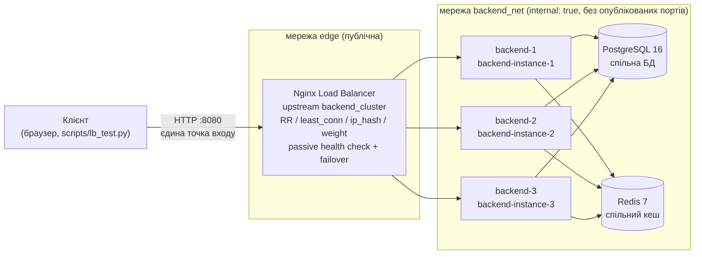
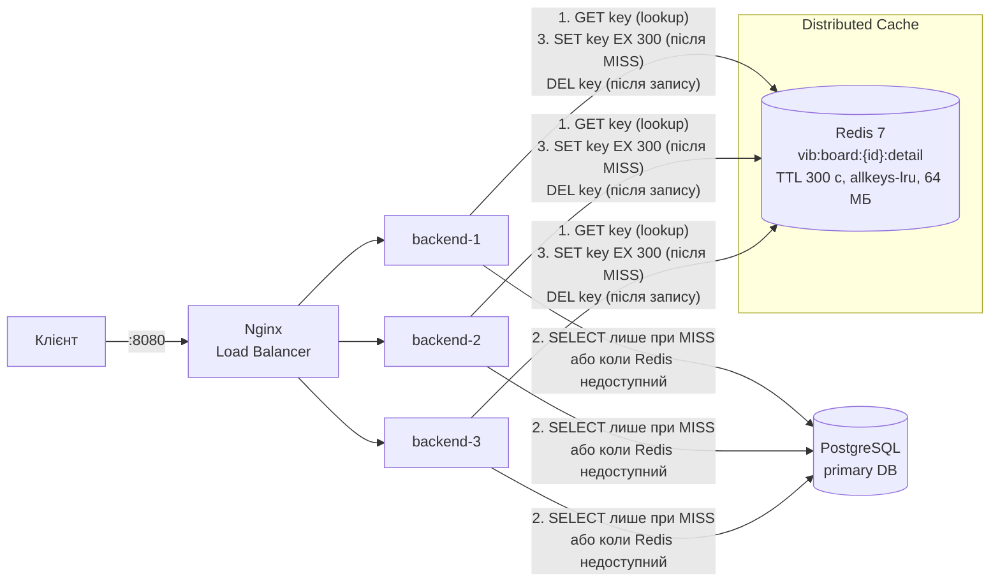
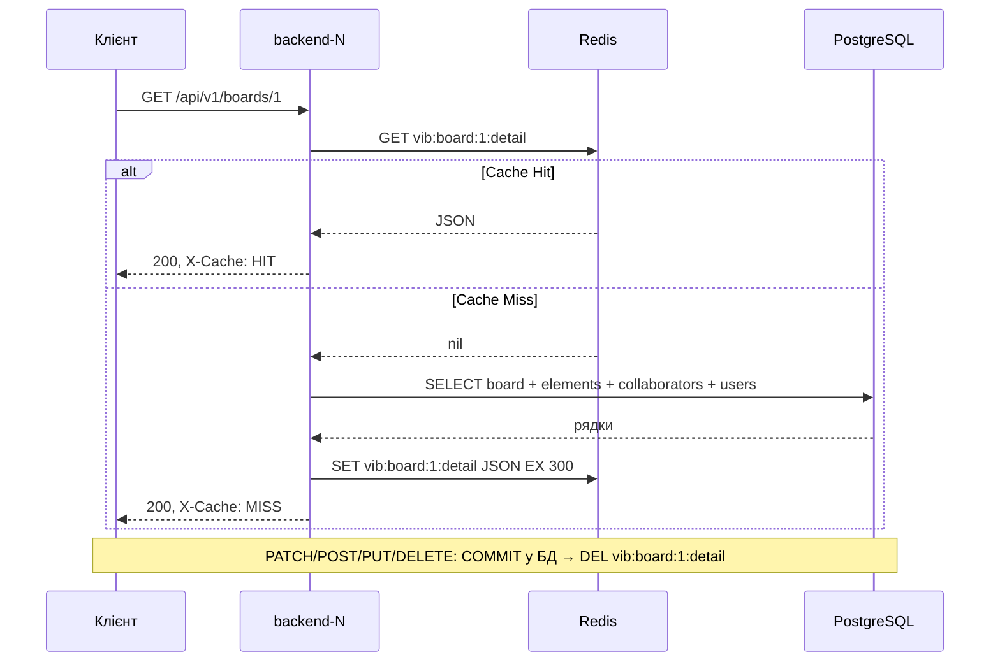

#  Visual Inspiration Boards (Collaborative Moodboard Platform)

> **Лабораторна робота № 1**: Проєктування архітектури (*System Design*) та реалізація базового прототипу розподіленої/модульної системи (MVP / Architectural Baseline).  
> **Лабораторна робота № 2**: Архітектура без стану (*Stateless Application Architecture*) та винесення стану системи (мульти-екземплярне розгортання, Round-Robin, `X-Instance-ID`, тестування стійкості).  
> **Лабораторна робота № 3**: Горизонтальне масштабування (*Horizontal Scaling*) та балансування навантаження (*Load Balancing*) — звіт у розділі [Лабораторна робота № 3](#лабораторна-робота--3-горизонтальне-масштабування-та-балансування-навантаження).  
> **Лабораторна робота № 4**: Розподілене кешування (*Distributed Caching*, Redis, Cache-Aside, інвалідація, fallback) — звіт у розділі [Лабораторна робота № 4](#лабораторна-робота--4-розподілене-кешування-та-узгодженість-даних).  
> **Естетика та інтерфейс:** Tiffany & Co. Aesthetic / Pinterest Vibe — бірюзові акценти `#0ABAB5`, стікери-нотатки, кольорові палітри, інтерактивний 2D-канвас із гострими кутами та підтримкою drag-and-drop.

---

##  Особливості платформи
- **Tiffany & Pinterest Aesthetic UI:**
  - Фірмова бірюзова палітра *Tiffany Blue* (`#0ABAB5`) та теплий фон `Warm Linen (#FAF8F5)`.
  - Суворі мінімалістичні форми з гострими кутами (0px border-radius).
  - Візуальні елементи канвасу: естетичні фотокартки, текстурні стікери, палітри кольорів із 5 зразками (копіювання HEX в один клік), цитати-стікери.
  - Інтерактивне переміщення мишкою (Drag-and-Drop) по 2D полотну.
  - Пакетна синхронізація (`Batch Sync`) з оптимістичним блокуванням (`Optimistic Concurrency Control`).
  - Відображення ідентифікатора активного stateless-вузла (`node: backend-instance-1 / 2`) у шапці.
- **Stateless Архітектура (Lab 2):**
  - **Interchangeable Workers:** 2 паралельні контейнери бекенду (`backend-1`, `backend-2`), повністю взаємозамінні, без in-memory залежностей.
  - **Round-Robin Load Balancing:** Nginx балансує трафік по черзі без Sticky Sessions.
  - **Node Identification:** заголовок відповіді `X-Instance-ID` дозволяє точно знати, який саме вузол обробив запит.
  - **Centralized Persistence & Distributed Cache:** спільні PostgreSQL 16 та Redis 7.
  - **Zero Data Loss on Node Death:** аварійна зупинка будь-якого екземпляра не призводить до втрати даних.

---

##  Як запустити проєкт

### Варіант 1: Декларативний запуск через Docker Compose (Рекомендовано для здачі)
Усе середовище (Nginx + 3 інстанси бекенду + PostgreSQL + Redis) піднімається **однією командою**:

```bash
docker compose up --build -d
```

Після запуску відкрийте у браузері:
- **Веб-інтерфейс:** [http://localhost:8080](http://localhost:8080) (єдина точка входу — Nginx)
- **Інтерактивна документація Swagger:** [http://localhost:8080/docs](http://localhost:8080/docs)
- **Health Check системи:** [http://localhost:8080/health](http://localhost:8080/health)

Зупинити стек із збереженням даних:
```bash
docker compose down
```

---

### Варіант 2: Локальний запуск (через Python Virtualenv)
Для швидкого запуску без підняття Docker сервіс автоматично використовує локальну базу даних:

```bash
# Windows PowerShell
.\.venv\Scripts\Activate.ps1
python main.py
```
Застосунок буде доступний на [http://localhost:8000](http://localhost:8000).

---

##  Автоматизоване тестування

### 1. Запуск повного набору тестів pytest (Lab 1 + Lab 2):
```bash
.\.venv\Scripts\pytest -v
```
*(Перевіряє Healthcheck, CRUD, пакетну синхронізацію, права доступу, заголовок `X-Instance-ID`, міжвузлову узгодженість `Cross-Instance Consistency` та аварійну зупинку `Instance Loss Recovery`).*

### 2. Live-демонстрація кластера на захисті (Lab 2 Script):
При запущеному Docker Compose виконайте скрипт демонстрації:
```bash
python scripts/verify_cluster.py http://localhost:8080
```
Скрипт наочно продемонструє:
1. Почерговий Round-Robin розподіл запитів між `backend-instance-1` та `backend-instance-2`.
2. Створення даних на вузлі №1 та їхнє миттєве зчитування/модифікацію вузлом №2 без Sticky Sessions.

---

##  Структура проєкту `visual_inspiration_boards`

| Шлях | Призначення |
|---|---|
| [`app/main.py`](file:///C:/Users/Tetiana/PycharmProjects/visual_inspiration_boards/app/main.py) | Точка входу FastAPI: CORS, middleware `X-Instance-ID`, статичні файли, обробка помилок. |
| [`app/api/v1/`](file:///C:/Users/Tetiana/PycharmProjects/visual_inspiration_boards/app/api/v1/) | Маршрутизатори REST API (`boards`, `elements`, `collaborators`, `users`, `health`). |
| [`app/models/`](file:///C:/Users/Tetiana/PycharmProjects/visual_inspiration_boards/app/models/) | ORM моделі SQLAlchemy (`User`, `Board`, `CanvasElement` з JSONB, `BoardCollaborator`). |
| [`app/schemas/`](file:///C:/Users/Tetiana/PycharmProjects/visual_inspiration_boards/app/schemas/) | DTO схеми Pydantic v2 (строга валідація, `HealthResponse` з `instance_id`). |
| [`app/services/`](file:///C:/Users/Tetiana/PycharmProjects/visual_inspiration_boards/app/services/) | Бізнес-логіка: сервіси дощок, пакетні операції (batch), автоініціалізація та demo-дані. |
| [`app/core/`](file:///C:/Users/Tetiana/PycharmProjects/visual_inspiration_boards/app/core/) | Базова конфігурація: підключення до БД, клієнт Redis, `INSTANCE_ID`. |
| [`app/static/`](file:///C:/Users/Tetiana/PycharmProjects/visual_inspiration_boards/app/static/) | Фронтенд: Tiffany UI, 2D-канвас, гострі кути, бейдж активного вузла. |
| [`docker/`](file:///C:/Users/Tetiana/PycharmProjects/visual_inspiration_boards/docker/) | `Dockerfile` та `nginx/nginx.conf` (балансувальник Lab 3: upstream-пул, алгоритми, passive health check, failover). |
| [`docker-compose.yml`](file:///C:/Users/Tetiana/PycharmProjects/visual_inspiration_boards/docker-compose.yml) | 3 бекенд-інстанси у приватній мережі `backend_net`, Postgres, Redis; назовні відкритий лише Nginx (`:8080`). |
| [`tests/`](file:///C:/Users/Tetiana/PycharmProjects/visual_inspiration_boards/tests/) | Інтеграційні тести API (`test_api.py`) та тести stateless стійкості (`test_stateless_resilience.py`). |
| [`scripts/verify_cluster.py`](file:///C:/Users/Tetiana/PycharmProjects/visual_inspiration_boards/scripts/verify_cluster.py) | Скрипт live-демонстрації Round-Robin та Cross-Instance узгодженості для захисту роботи. |
| [`scripts/cache_demo.py`](file:///C:/Users/Tetiana/PycharmProjects/visual_inspiration_boards/scripts/cache_demo.py) | Lab 4: демонстрація Cache Hit/Miss, інвалідації та заміри Cold vs Hot. |
| [`scripts/lb_test.py`](file:///C:/Users/Tetiana/PycharmProjects/visual_inspiration_boards/scripts/lb_test.py) | Lab 3: навантажувальний тест через балансувальник (розподіл по Instance-ID, req/s, p50/p99, помилки). |
| [`REPORT_LAB1.md`](file:///C:/Users/Tetiana/PycharmProjects/visual_inspiration_boards/REPORT_LAB1.md) | Звіт з Лабораторної роботи №1 (System Design & MVP). |
| [`REPORT_LAB2.md`](file:///C:/Users/Tetiana/PycharmProjects/visual_inspiration_boards/REPORT_LAB2.md) | **Звіт з Лабораторної роботи №2 (Stateless Architecture & Resilience).** |

---

##  Лабораторна робота № 3: Горизонтальне масштабування та балансування навантаження

### Архітектура



| Що змінено | Файл |
|---|---|
| Пул із 3 реплік, приватна мережа, опублікований лише порт Nginx | [`docker-compose.yml`](docker-compose.yml) |
| Upstream-пул, алгоритми, passive health check, failover | [`docker/nginx/nginx.conf`](docker/nginx/nginx.conf) |
| `GET /health` — готовність вузла (200 / 503) | [`app/api/v1/endpoints/health.py`](app/api/v1/endpoints/health.py), [`app/main.py`](app/main.py) |
| Синтетичний запит `GET /api/v1/lab/work?cpu_ms=N` | [`app/api/v1/endpoints/lab.py`](app/api/v1/endpoints/lab.py) |
| Штучна затримка вузла `ARTIFICIAL_DELAY_MS` | [`app/core/config.py`](app/core/config.py), [`app/main.py`](app/main.py) |
| Навантажувальний тест (лише стандартна бібліотека Python) | [`scripts/lb_test.py`](scripts/lb_test.py) |

Умови вимірювань: Docker Desktop (Windows 11, 16 CPU), кожен backend — один процес uvicorn (одне ядро), клієнт `scripts/lb_test.py` запущено на тому ж хості. Абсолютні числа залежать від машини, важливі співвідношення.

### 2.1. Пул backend-сервісів

* Три репліки `backend-1..3` зібрані з одного образу, мають окремі контейнери (окремий життєвий цикл: кожну можна зупинити чи перезапустити незалежно від інших) і працюють зі спільними PostgreSQL та Redis.
* Кожна репліка повертає свій ідентифікатор у заголовку `X-Instance-ID` та в полі `instance_id` відповіді `/health`.

```text
> curl http://localhost:8080/health   (3 рази)
{"status":"healthy","instance_id":"backend-instance-3","database":"healthy","redis":"healthy",...}
{"status":"healthy","instance_id":"backend-instance-2","database":"healthy","redis":"healthy",...}
{"status":"healthy","instance_id":"backend-instance-1","database":"healthy","redis":"healthy",...}
```

### 2.2. Єдина точка входу

* У `docker-compose.yml` секція `ports:` є **лише у `nginx`** (`8080:80`). Backend-и, PostgreSQL і Redis портів не публікують (у Lab 2 Postgres і Redis були відкриті на `5432`/`6379` — тепер закрито).
* Мережа `backend_net` має `internal: true`: до неї під'єднаний лише Nginx (він також у публічній мережі `edge`). Клієнт не може звернутися до приватних адрес інстансів:

```text
> docker compose ps
vib_backend_1  Up (healthy)  8000/tcp                 <- порт не опублікований
vib_backend_2  Up (healthy)  8000/tcp
vib_backend_3  Up (healthy)  8000/tcp
vib_nginx      Up            0.0.0.0:8080->80/tcp     <- єдина точка входу
vib_postgres   Up (healthy)  5432/tcp
vib_redis      Up (healthy)  6379/tcp
> curl http://localhost:8000/health   -> з'єднання відхилено
```

### 2.3. Порівняння алгоритмів балансування

Алгоритм задається одним рядком у `upstream backend_cluster` ([`nginx.conf`](docker/nginx/nginx.conf)); перемикання без зупинки — `docker compose exec nginx nginx -s reload`.

**Рівномірне навантаження** (`/api/v1/lab/work?cpu_ms=5`, 1500 запитів, 20 паралельних):

| Алгоритм | backend-1 | backend-2 | backend-3 | req/s | p50, мс | p99, мс |
|---|---|---|---|---|---|---|
| Round Robin | 500 (33.3%) | 500 (33.3%) | 500 (33.3%) | 302.1 | 61.0 | 188.9 |
| Least Connections | 500 (33.3%) | 499 (33.3%) | 501 (33.4%) | 297.8 | 65.5 | 100.6 |
| Weighted RR 3:2:1 (1200 запитів) | 600 (50.0%) | 400 (33.3%) | 200 (16.7%) | 218.0 | 104.8 | 204.9 |
| IP Hash (`/health`, 300 запитів) | 300 (100%) | 0 | 0 | — | — | — |

* **Round Robin** — строго по черзі, рівні частки незалежно від стану вузлів.
* **Least Connections** — на однакових вузлах розподіл такий самий, але p99 нижчий: запит не стає в чергу до вузла, який ще зайнятий попередніми.
* **Weighted RR** розподіляє точно за вагами 3:2:1. Оскільки вузли насправді однакові, backend-1 перевантажився (середній час 156.9 мс проти ~25 мс на інших) і загальна пропускна здатність впала. Висновок: ваги мають відповідати реальній потужності вузлів (кількості CPU), інакше Weighted RR шкодить.
* **IP Hash** — усі запити одного клієнта (одна IP-адреса) потрапили на один вузол: сесійна прив'язка на мережевому рівні. Мінус — нерівномірність: усі клієнти за одним NAT потрапляють на один вузол (через Docker Desktop усі запити з хоста приходять з однієї адреси шлюзу).

**Асиметричне навантаження:** backend-3 отримує штучну затримку `ARTIFICIAL_DELAY_MS=200` (`/api/v1/lab/work`, 1500 запитів, 30 паралельних):

| Алгоритм | backend-1 | backend-2 | backend-3 (повільний) | req/s | p50, мс | p99, мс |
|---|---|---|---|---|---|---|
| Round Robin | 500 (33.3%) | 500 (33.3%) | 500 (33.3%), avg 226 мс | 334.2 | 17.3 | **299.1** |
| Least Connections | 657 (43.8%) | 640 (42.7%) | 203 (13.5%), avg 220 мс | 324.2 | 67.1 | **233.4** |

Те саме з CPU-навантаженням (`cpu_ms=5`): Round Robin p99 = **465.0** мс, Least Connections p99 = **330.1** мс (розподіл 41.3% / 41.3% / 17.4%).

Висновки:
* Round Robin «не бачить» деградації: третина запитів іде на повільний вузол, і саме вони формують хвіст розподілу — p99 ≈ затримка повільного вузла.
* Least Connections автоматично зменшує частку повільного вузла (на ньому довше висять з'єднання) з 33% до 13–17% і знижує p99 на 22–29%.
* Пропускна здатність майже не змінилася: трафік, знятий з повільного вузла, перейшов на два швидкі, які вже працювали на межі одного ядра (p50 зріс з 17 до 67 мс). Тобто Least Connections краще утилізує здорові вузли, але не додає потужності.

### 2.4. Health Check та відмовостійкість

**`GET /health`** ([`health.py`](app/api/v1/endpoints/health.py)) виконує `SELECT 1` до PostgreSQL та `PING` до Redis:

| Стан | HTTP | `status` |
|---|---|---|
| БД і Redis доступні | 200 | `healthy` |
| БД доступна, Redis — ні (працює in-memory fallback) | 200 | `degraded` |
| БД недоступна | **503** | `unhealthy` |

Перевірка при зупиненій PostgreSQL:
```text
{"status":"unhealthy","instance_id":"backend-instance-1","database":"unhealthy: [Errno -3] Temporary failure in name resolution",...}  HTTP 503
```

Механізми виключення вузла з пулу:
1. **Passive health check (Nginx):** `max_fails=2 fail_timeout=10s` — після 2 невдалих спроб вузол виключається на 10 с.
2. **Повтор запиту на іншому вузлі:** `proxy_next_upstream error timeout http_502 http_503 http_504` — якщо вузол не відповів або повернув 502/503/504, Nginx відправляє той самий запит на наступний вузол; клієнт помилки не бачить.
3. **Динамічний склад пулу:** `server ... resolve` + `resolver 127.0.0.11 valid=5s` — Nginx кожні 5 с перечитує DNS Docker; зупинений контейнер зникає з пулу, запущений — автоматично повертається.
4. **Active health check (Docker):** `HEALTHCHECK` у [`Dockerfile`](docker/Dockerfile) кожні 15 с опитує `/health` і показує стан `healthy/unhealthy` у `docker compose ps`.

> Безкоштовна версія Nginx підтримує лише пасивні перевірки; активні (`health_check`) є в Nginx Plus, HAProxy (`option httpchk`) або Traefik.

**Експеримент з відмовою вузла** (4000 запитів `/api/v1/lab/work`, 10 паралельних; вузол зупиняється на початку прогону):

| Сценарій | Запитів | Помилок 5xx | req/s | p99, мс | Розподіл |
|---|---|---|---|---|---|
| `docker stop vib_backend_2` (коректна зупинка) | 4000 | **0** | 274.4 | 85.3 | b1 2567 / **b2 76** / b3 1357 |
| `docker kill vib_backend_1` (раптове падіння) | 4000 | **0** | 265.5 | 80.4 | **b1 66** / b2 1316 / b3 2618 |

Після зупинки вузол встиг обробити лише 66–76 запитів, решту трафіку без жодної помилки прийняли два інші вузли. Помилку з'єднання з мертвим вузлом (connection refused) перехоплює `proxy_next_upstream` і повторює запит на живому вузлі.

### 2.5. Scale-out та аналіз вузьких місць

**CPU-важкий запит** (`/api/v1/lab/work?cpu_ms=10`, 2000 запитів, 30 паралельних):

| Інстансів | req/s | Приріст | p50, мс | p99, мс |
|---|---|---|---|---|
| 1 | 71.6 | ×1.00 | 414.7 | 475.2 |
| 2 | 140.7 | ×1.96 | 210.8 | 283.6 |
| 3 | 209.3 | ×2.92 | 122.0 | 273.9 |

**Легкий запит** (лише `SELECT 1` до БД, `/api/v1/lab/work`, 30 паралельних):

| Інстансів | req/s | Приріст | p99, мс |
|---|---|---|---|
| 1 | 258.5 | ×1.00 | 172.0 |
| 3 | 442.0 | ×1.71 | 158.4 |

Завантаження під час прогону легкого запиту на 3 інстансах (`docker stats`, 100% = одне ядро):

| Компонент | Значення |
|---|---|
| backend-1 / 2 / 3, CPU | 102% / 101% / 101% — кожен процес uvicorn використовує рівно одне ядро |
| PostgreSQL, CPU | 45% — одна спільна БД для всіх вузлів |
| Nginx, CPU | 40% |
| Активних з'єднань з БД (`pg_stat_activity`) | 31 |

**Висновки щодо вузьких місць:**
1. Поки запит обмежений CPU бекенду, масштабування майже лінійне (×2.92 на 3 вузлах): stateless-вузли нічого не ділять, крім сховищ.
2. Для легких запитів приріст лише ×1.71: частка роботи спільних компонентів (PostgreSQL, Nginx, мережа) стає помітною. Навантаження на PostgreSQL росте пропорційно сумарному трафіку всіх вузлів, бо всі вони звертаються до однієї БД.
3. **Наступне обмеження — база даних, а саме пул з'єднань.** Кожен інстанс має власний пул SQLAlchemy (за замовчуванням `pool_size=5` + `max_overflow=10` = до 15 з'єднань), а PostgreSQL за замовчуванням має `max_connections=100`. На 3 вузлах уже 31 з'єднання; при ~7 інстансах (7 × 15 = 105) сумарний пул перевищить ліміт і вузли почнуть отримувати помилки `too many connections`. Додавання бекендів після цього лише збільшить конкуренцію за з'єднання та CPU PostgreSQL.
   Шляхи розв'язання: PgBouncer (пулер з'єднань), read-репліки PostgreSQL, кешування читань у Redis.
4. CPU Nginx (40% при 442 req/s) і мережа поки не є обмеженням. Shared Storage Locks у цьому тесті не виникають (запити лише читають); у реальному сценарії конкуренція за рядки з'являється при одночасному редагуванні однієї дошки — її обробляє оптимістичне блокування (поле `version`, Lab 1–2).

### Single Point of Failure: балансувальник

Після масштабування бекендів єдиною точкою відмови стає **сам Nginx**: якщо впаде контейнер `vib_nginx`, недоступна вся система, хоча всі бекенди працюють. Шляхи усунення:
* **Keepalived / VRRP (active-passive):** два Nginx на різних хостах ділять одну віртуальну IP-адресу (VIP). Основний вузол постійно надсилає VRRP-оголошення; якщо вони зникають, резервний вузол забирає VIP за 1–3 с. Клієнт продовжує звертатися на ту саму IP-адресу.
* **DNS Round Robin:** одне доменне ім'я має кілька A-записів (кілька балансувальників). Простий спосіб, але DNS не перевіряє стан вузлів, а клієнти кешують записи на час TTL, тож перемикання повільне.
* **Керований хмарний балансувальник** (AWS ELB, GCP Load Balancing) — високу доступність забезпечує провайдер.

### Сценарій демонстрації на захисті (PowerShell)

```powershell
docker compose up --build -d                              # 1. запуск кластера
python scripts/lb_test.py /health 30 1                    # 2. розподіл по Instance-ID (Round Robin)

# 3. Live-перемикання алгоритму: у docker/nginx/nginx.conf розкоментувати "least_conn;", потім:
docker compose exec nginx nginx -s reload
python scripts/lb_test.py /api/v1/lab/work 1500 30

# 4. Повільний вузол (асиметричне навантаження) і повернення до норми
$env:BACKEND_3_DELAY_MS=200; docker compose up -d backend-3
Remove-Item Env:BACKEND_3_DELAY_MS; docker compose up -d backend-3

# 5. Аварія: у першому терміналі навантаження, у другому — зупинка вузла
python scripts/lb_test.py /api/v1/lab/work 4000 10
docker stop vib_backend_2          # у результаті не має бути рядка ERROR
docker start vib_backend_2

# 6. Scale-out: 1 інстанс -> 3 інстанси
docker compose stop backend-2 backend-3
python scripts/lb_test.py "/api/v1/lab/work?cpu_ms=10" 2000 30
docker compose start backend-2 backend-3
python scripts/lb_test.py "/api/v1/lab/work?cpu_ms=10" 2000 30
```

---

##  Лабораторна робота № 4: Розподілене кешування та узгодженість даних

### Архітектура з кешувальним шаром



Потік запиту `GET /api/v1/boards/{id}` (Cache-Aside):



| Що змінено | Файл |
|---|---|
| Ключ кешу, клієнт Redis, fallback без локальної пам'яті | [`app/core/redis.py`](app/core/redis.py) |
| Cache-Aside для деталей дошки | [`app/services/board_service.py`](app/services/board_service.py) — `get_board_detail_cached` |
| Заголовок `X-Cache: HIT / MISS` | [`app/api/v1/endpoints/boards.py`](app/api/v1/endpoints/boards.py), CORS `expose_headers` у [`app/main.py`](app/main.py) |
| TTL `BOARD_CACHE_TTL = 300` | [`app/core/config.py`](app/core/config.py) |
| Інвалідація у всіх операціях запису | [`board_service.py`](app/services/board_service.py), [`element_service.py`](app/services/element_service.py), [`collaborator_service.py`](app/services/collaborator_service.py) |
| Redis: ліміт пам'яті, LRU, без збереження на диск | [`docker-compose.yml`](docker-compose.yml) |
| Демонстрація Hit/Miss, інвалідації, Cold vs Hot | [`scripts/cache_demo.py`](scripts/cache_demo.py) |

### 2.1. Аналіз та вибір об'єкта кешування

| Endpoint | Читання | Запис | Допустиме застарівання | Вартість запиту | Рішення |
|---|---|---|---|---|---|
| **`GET /api/v1/boards/{id}`** — дошка + усі елементи + співавтори | **Найчастіше:** кожне відкриття дошки кожним учасником; одну дошку відкривають багато людей | Лише при редагуванні цієї дошки (batch sync, елементи, співавтори) | Свої зміни мають бути видні одразу → потрібна інвалідація | **4 SQL-запити** (board, elements, collaborators, users) + серіалізація JSONB-вмісту елементів (~5.5 КБ на демо-дошці з 6 елементів) | ✅ **Кешуємо** |
| `GET /api/v1/boards` (список) | Часто | Будь-яка зміна будь-якої дошки змінює список | Низьке | Великий простір параметрів (`skip`, `limit`, `owner_id`, `search`) → багато ключів, низький hit rate, складна інвалідація | ❌ |
| `GET /boards/{id}/export` | Рідко (разова дія) | — | — | Містить `exported_at`, кожен результат унікальний | ❌ |
| `GET /boards/{id}/elements` | Рідко (UI бере елементи з деталей дошки) | Часто | — | Підмножина деталей дошки | ❌ |
| `GET /health` | Часто | — | **Нуль** — має відображати реальний стан | — | ❌ ніколи |

**Обґрунтування:** деталі дошки — класичний read-intensive сценарій. Читань набагато більше, ніж записів (запис робить лише той, хто редагує, а читає кожен, хто відкриває). Це найдорожчий запит до БД у системі, і він має природний єдиний ключ — `board_id`.

### 2.2. Розподілене сховище кешу

* Redis 7 — окремий контейнер `vib_redis` у спільній приватній мережі `backend_net` ([`docker-compose.yml`](docker-compose.yml)). Усі три backend-інстанси підключаються до одного `redis://redis:6379/0`, тож кеш у них спільний.
* Доказ рівноправного доступу: кеш заповнює один вузол, а HIT віддають інші:
  ```text
  GET (холодний)    X-Cache=MISS  backend-instance-1   52.2 ms
  GET (повторний)   X-Cache=HIT   backend-instance-3    9.2 ms
  GET (повторний)   X-Cache=HIT   backend-instance-2    9.3 ms
  ```
* Налаштування Redis як кешу: `--maxmemory 64mb --maxmemory-policy allkeys-lru --save ""` і `tmpfs: /data`. Збереження на диск вимкнено навмисно: якщо дані змінилися, поки Redis був вимкнений, інвалідація не відбулася. Без цих налаштувань після рестарту Redis підняв би старий знімок і віддавав застарілу дошку до кінця TTL (у ході роботи це відтворилося: версія 33 замість 34). Тепер після рестарту кеш порожній.
* У Lab 2–3 клієнт Redis при недоступності писав у **локальну пам'ять процесу**. У кластері це ламало б узгодженість: інвалідація на backend-1 не очищала б пам'ять backend-2. Цей fallback прибрано (див. 2.6).

### 2.3. Cache-Aside

Реалізація — [`BoardService.get_board_detail_cached`](app/services/board_service.py):

```python
key = board_cache_key(board_id)
cached = await cache.get_json(key)          # 1. Key Lookup
if cached is not None:
    return cached, "HIT"                     # 2. Cache Hit: без звернення до БД

board = await BoardService.get_board_by_id(db, board_id)                 # 3. Cache Miss: читаємо з БД,
data = BoardDetailRead.model_validate(board).model_dump(mode="json")
await cache.set_json(key, data, ttl=settings.BOARD_CACHE_TTL)            #    кладемо в кеш з TTL,
return data, "MISS"                                                      #    повертаємо клієнту
```

Endpoint `GET /api/v1/boards/{id}` ([`boards.py`](app/api/v1/endpoints/boards.py)) виставляє `X-Cache` і повертає дані. У кеш кладеться готовий JSON відповіді (`BoardDetailRead`), тож HIT не потребує ні БД, ні ORM-серіалізації.

### 2.4. Схема ключів та політика TTL

**Шаблон ключа:** `vib:board:{board_id}:detail` (функція `board_cache_key` у [`redis.py`](app/core/redis.py) — єдине місце, де формується ключ; його використовують і читання, і всі інвалідації).

| Частина | Значення | Навіщо |
|---|---|---|
| `vib` | простір імен застосунку | Redis може використовуватися іншими сервісами, ключі не перетнуться |
| `board` | сутність | відрізняє від майбутніх `vib:user:...` |
| `{board_id}` | первинний ключ БД | унікальний → колізій між дошками немає |
| `detail` | представлення (view) | одна дошка може мати кілька кешованих форм (наприклад, `:export`) — вони не перетнуться |

**Простір параметрів:** endpoint має лише параметр шляху `board_id`, query-параметрів немає, тому відповідь повністю визначається `board_id`. Хеш параметрів не потрібен. Якби з'явилися параметри (наприклад, `?fields=`), до ключа додавався б `:{md5(відсортовані параметри)}`, щоб однакові набори параметрів давали однаковий ключ.

**TTL = 300 с** (`BOARD_CACHE_TTL` у [`config.py`](app/core/config.py)):
* Актуальність гарантує **інвалідація** (2.5), а не TTL. TTL — страховка на випадок, коли інвалідація не спрацювала (Redis був недоступний під час запису, або сталася гонка: читач на іншому вузлі встиг записати старі дані відразу після `DEL`). Максимальний час застарівання в такому разі — 5 хв.
* Довший TTL дав би більше застарілих даних у збійних сценаріях; коротший — більше MISS для популярних дошок, які не змінюються.
* `ttl vib:board:1:detail` одразу після MISS = `299`.

### 2.5. Інвалідація кешу

Після кожного успішного `COMMIT` у БД виконується `DEL vib:board:{id}:detail`. Порядок «спочатку БД, потім видалення ключа» важливий: якщо видалити ключ до коміту, паралельний читач встигне закешувати старі дані.

| Операція | Endpoint | Де інвалідується |
|---|---|---|
| Оновлення дошки | `PATCH /api/v1/boards/{id}` | `BoardService.update_board` |
| Видалення дошки | `DELETE /api/v1/boards/{id}` | `BoardService.delete_board` |
| Створення елемента | `POST /api/v1/boards/{id}/elements` | `ElementService.create_element` |
| Зміна елемента | `PUT /api/v1/boards/{id}/elements/{el}` | `ElementService.update_element` |
| Видалення елемента | `DELETE /api/v1/boards/{id}/elements/{el}` | `ElementService.delete_element` |
| Пакетна синхронізація канвасу | `POST /api/v1/boards/{id}/elements/batch` | `ElementService.batch_update_elements` |
| Додавання / зміна ролі співавтора | `POST /api/v1/boards/{id}/collaborators` | `CollaboratorService.add_collaborator` *(додано в Lab 4)* |
| Видалення співавтора | `DELETE /api/v1/boards/{id}/collaborators/{user}` | `CollaboratorService.remove_collaborator` *(додано в Lab 4)* |

Перевірка:
```text
== 2. Інвалідація  (scripts/cache_demo.py)
PATCH /boards/{id}  -> cache.delete(key)
GET після PATCH   X-Cache=MISS  backend-instance-3   18.4 ms  version=3  description='Lab 4 demo: changed at 19:56:44'
GET повторний     X-Cache=HIT   backend-instance-2    5.4 ms  version=3  description='Lab 4 demo: changed at 19:56:44'

Нова дошка 6:  GET → MISS,  GET → HIT,  POST element → 201,  GET → MISS,  GET → HIT,  DELETE board → 204,  GET → 404
```
Перший GET після мутації — завжди MISS зі свіжими даними (нова `version`), навіть якщо читає інший вузол.

### 2.6. Метрики, продуктивність та Fallback

**Hit / Miss / Invalidation:**
* Заголовок `X-Cache: HIT | MISS` у кожній відповіді `GET /api/v1/boards/{id}`.
* Логи бекенда: `CACHE HIT vib:board:1:detail`, `CACHE MISS ...`, `CACHE INVALIDATE ...`, `CACHE BYPASS ...` (Redis недоступний) — `docker logs vib_backend_1`.
* Лічильники Redis: `docker exec vib_redis redis-cli info stats | grep keyspace`.

**Cold vs Hot** (`python scripts/cache_demo.py 1 30`; дошка: 6 елементів, 2 співавтори, 5.5 КБ JSON; час клієнта через Nginx):

| Запит | Кількість | avg, мс | p50, мс | p95, мс |
|---|---|---|---|---|
| Cold (MISS: Redis → 4 SQL → SET у Redis) | 30 | 12.7 | 11.9 | 15.2 |
| Hot (HIT: лише Redis) | 150 | **6.0** | **5.5** | **6.4** |

Гарячий запит **у ~2 рази швидший**. Із цих ~6 мс більша частина — накладні витрати HTTP, Nginx і FastAPI, які однакові для обох випадків; сама робота з БД (~7 мс) при HIT зникає повністю.

**Під навантаженням** (`python scripts/lb_test.py /api/v1/boards/1 2000 20`):

| Режим | req/s | p50, мс | p99, мс | Запитів до БД |
|---|---|---|---|---|
| З кешем (Redis працює) | **626.6** | **30.9** | **51.0** | 0 (Redis: `keyspace_hits:2000`, `keyspace_misses:0`) |
| Без кешу (Redis зупинено, fallback на БД) | 228.8 | 84.9 | 156.6 | 2000 × 4 SQL |

Кеш дав **×2.7 пропускної здатності** і втричі нижчий p99, а PostgreSQL повністю розвантажено для цього сценарію. Так знімається вузьке місце, визначене в Lab 3 (БД і пул з'єднань).

**Fallback testing** (`docker stop vib_redis`):

| Перевірка | Результат |
|---|---|
| `GET /api/v1/boards/1` | **200**, ~20 мс, `X-Cache: MISS`, дані з PostgreSQL, на всіх трьох вузлах |
| `PATCH /api/v1/boards/1` | **200**, зміна збережена в БД (інвалідація пропущена з `CACHE BYPASS`) |
| `GET /health` | **200**, `"status":"degraded"`, `"redis":"disconnected (fallback active)"` — вузол лишається в пулі балансувальника |
| Лог | `CACHE BYPASS get vib:board:1:detail: Redis unavailable (... Temporary failure in name resolution.)` |
| `docker start vib_redis` | кеш порожній → перший GET = MISS зі **свіжими** даними (`'edited while Redis is down'`, нова версія), далі HIT |

Як це реалізовано ([`redis.py`](app/core/redis.py)):
* Кожен виклик Redis обгорнутий у `try/except`; при помилці `get_json` повертає `None` (= MISS → БД), а `set_json`/`delete` нічого не роблять.
* `socket_connect_timeout=0.5`, `socket_timeout=0.5` — мертвий Redis не «підвішує» запит.
* Клієнт створюється завжди, навіть якщо Redis недоступний при старті, і сам перепідключається, коли Redis повертається. Після рестарту Redis кожен вузол один раз натрапляє на закрите з'єднання (`CACHE BYPASS ... Connection closed by server`) і віддає дані з БД, а з наступного запиту знову працює з кешем.

### Теоретичні питання

**Cache Stampede / Thundering Herd.** Популярний ключ зникає (TTL або інвалідація), і в цей момент сотні паралельних запитів одночасно отримують MISS. Усі вони йдуть у БД з однаковим важким запитом і всі пишуть той самий результат у кеш, тож БД отримує сплеск навантаження саме тоді, коли кеш мав її захищати. У нашій реалізації це можливо при одночасному відкритті щойно зміненої дошки. Способи захисту:
* блокування на перебудову: лише перший запит отримує `SET lock:key NX EX 5` і йде в БД, інші коротко чекають або віддають старі дані;
* імовірнісне раннє оновлення (оновити ключ трохи раніше закінчення TTL);
* stale-while-revalidate: віддавати старе значення, поки одна задача оновлює кеш.

**Cache Avalanche.** Масове одночасне зникнення багатьох ключів: усі ключі закешовані одночасно з однаковим TTL і разом протухли, або впав чи перезапустився сам Redis (у нас кеш після рестарту порожній). Навантаження на БД стрибає до рівня «без кешу» (у нашому тесті — з 0 до 2000×4 SQL-запитів). Захист:
* випадковий розкид TTL (`300 ± random(0..60)`);
* прогрів кешу після рестарту;
* реплікація або Sentinel/Cluster для Redis;
* обмеження з'єднань до БД (circuit breaker), щоб вона не впала від сплеску.

**Eviction (витіснення)** — що видаляти, коли пам'ять Redis заповнена (`maxmemory`):
* **LRU** (Least Recently Used) — найдавніше використаний ключ. Добре підходить, коли «гарячими» є нещодавно відкриті дошки. **Налаштовано:** `allkeys-lru`.
* **LFU** (Least Frequently Used) — найрідше використаний ключ. Краще, коли є стабільно популярні об'єкти, бо разовий доступ до старого ключа не «рятує» його від витіснення.
* Також є `volatile-*` (витісняти лише ключі з TTL), `allkeys-random`, `noeviction` (помилка запису при переповненні — для кешу не підходить).

**Expiration vs Invalidation:**
* **Expiration (TTL)** — пасивне, за часом: ключ зникає сам через N секунд, незалежно від того, чи змінилися дані. Дає *eventual consistency*: дані можуть бути застарілими до N секунд. Простий, не вимагає знати, хто змінює дані.
* **Invalidation** — активне, за подією: код, що змінює дані, явно видаляє ключ (`DEL`) одразу після запису. Дає свіжі дані на наступному читанні, але потребує, щоб **кожне** місце запису знало про кеш (у нас — 8 операцій).
* У проєкті вони працюють разом: інвалідація відповідає за свіжість, TTL — страховка від пропущених інвалідацій.

### Висновок

У лабораторній роботі до масштабованої системи з Lab 3 (Nginx + 3 stateless-інстанси + PostgreSQL) додано розподілений кешувальний шар на Redis. Він розвантажує основну базу даних і зменшує затримку read-intensive операцій, не порушуючи узгодженості даних між вузлами.

1. **Вибір об'єкта кешування.** Ендпоінти порівнювались за частотою читання і запису, допустимим застаріванням даних та вартістю запиту. Обрано `GET /api/v1/boards/{id}`:
   * дошку читає кожен учасник при кожному відкритті, а змінюють її значно рідше;
   * це найдорожчий запит системи — 4 SQL-запити плюс серіалізація JSONB-елементів;
   * відповідь повністю визначається одним параметром `board_id`.

   Список дощок, експорт і `/health` свідомо не кешуються: великий простір параметрів, унікальні відповіді або вимога нульового застарівання.
2. **Розподілене сховище.** Redis працює окремим контейнером у приватній мережі і спільний для всіх трьох backend-інстансів. Тому кеш, заповнений одним вузлом, одразу використовують інші: MISS на backend-1, HIT на backend-2 і backend-3. Redis налаштований саме як кеш:
   * ліміт пам'яті 64 МБ з витісненням `allkeys-lru`;
   * без збереження на диск, щоб після рестарту не віддавати застарілий знімок.
3. **Cache-Aside.** Реалізовано за алгоритмом із завдання:
   * пошук за ключем;
   * при HIT — відповідь без звернення до БД;
   * при MISS — читання з PostgreSQL, запис у Redis з TTL і відповідь клієнту.

   Джерело даних видно в заголовку `X-Cache: HIT/MISS` та в логах вузлів.
4. **Ключі та TTL.** Ключ має детермінований формат `vib:board:{board_id}:detail` (простір імен, сутність, ідентифікатор, представлення). Він формується в одному місці, тому колізії неможливі, а читання та інвалідація завжди використовують той самий ключ. TTL = 300 с слугує страховкою від пропущених інвалідацій, а не основним механізмом актуальності.
5. **Інвалідація.** Після кожного успішного `COMMIT` у всіх 8 операціях, що змінюють дошку, її елементи чи співавторів, ключ видаляється з Redis. Тому перший запит після мутації гарантовано отримує свіжі дані з БД, навіть якщо його обробляє інший вузол. Під час роботи виявлено, що зміна співавторів не скидала кеш, і це виправлено.
6. **Продуктивність і відмовостійкість.**
   * **Затримка:** гарячий запит у середньому вдвічі швидший за холодний (6.0 мс проти 12.7 мс).
   * **Пропускна здатність:** під навантаженням кеш дав ×2.7 (626.6 проти 228.8 req/s) і втричі нижчий p99.
   * **Розвантаження БД:** у тесті з 2000 запитів жоден не дійшов до PostgreSQL (2000 HIT, 0 MISS). Отже, кеш знімає вузьке місце, визначене в Lab 3: навантаження на БД і її пул з'єднань.
   * **Fallback:** при аварійній зупинці Redis система лишається працездатною — запити обслуговуються напряму з БД з відповіддю 200, а `/health` повідомляє `degraded`. Після повернення Redis вузли самі перепідключаються. Локальний in-memory fallback прибрано свідомо: окремий кеш у пам'яті кожного вузла порушив би узгодженість у кластері.

**Підсумок.** Кешування — це компроміс між швидкістю та актуальністю даних. Поєднання Cache-Aside, явної інвалідації після запису і TTL як страховки дає систему, яка:
* швидко віддає дані з кешу;
* розвантажує базу даних;
* не повертає застарілих даних після змін;
* залишається працездатною при відмові кешу.

Слабкі місця, що залишаються, і шляхи їх усунення:
* **Cache Stampede** — одночасні MISS на популярний ключ. Розв'язується блокуванням на перебудову (`SET NX`).
* **Cache Avalanche** — масове зникнення ключів, наприклад після рестарту Redis. Розв'язується випадковим розкидом TTL і прогрівом кешу.
* **Redis як єдина точка відмови** — розв'язується реплікацією через Redis Sentinel або Cluster.

### Сценарій демонстрації на захисті (PowerShell)

```powershell
docker compose up --build -d

# 1. Hit / Miss + 2. Інвалідація + Cold vs Hot — одним скриптом
python scripts/cache_demo.py 1 30

#    або вручну: перший запит MISS, повторний HIT
curl.exe -s -D - -o NUL http://localhost:8080/api/v1/boards/1 | findstr /i "x-cache x-instance"
curl.exe -s -D - -o NUL http://localhost:8080/api/v1/boards/1 | findstr /i "x-cache x-instance"
docker exec vib_redis redis-cli keys "vib:*"
docker exec vib_redis redis-cli ttl vib:board:1:detail
docker logs vib_backend_1 --tail 5          # CACHE HIT / MISS / INVALIDATE

# 3. Fallback: аварійна зупинка Redis
docker stop vib_redis
curl.exe -s -D - -o NUL http://localhost:8080/api/v1/boards/1 | findstr /i "HTTP x-cache"   # 200, MISS (з БД)
curl.exe -s http://localhost:8080/health                                                     # degraded, але 200
python scripts/lb_test.py /api/v1/boards/1 500 10                                            # 0 помилок
docker start vib_redis
```
