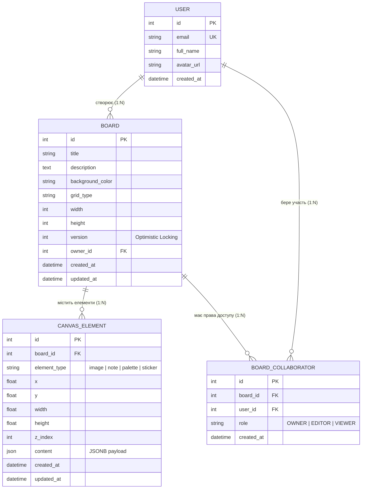
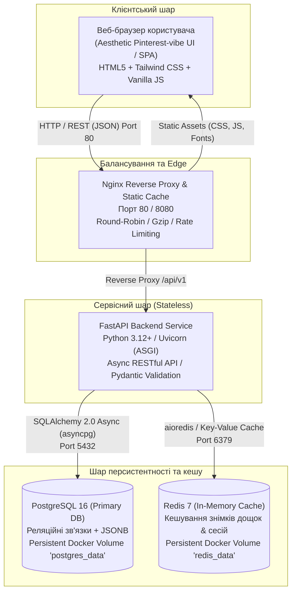

# Звіт з Лабораторної роботи №1
**Тема:** Проєктування архітектури (System Design) та реалізація базового прототипу розподіленої/модульної системи (MVP / Architectural Baseline)  
**Проєкт:** Платформа інтерактивних дошок візуального натхнення (*Collaborative Moodboard Canvas Platform* — Inspiration Boards)  

---

## 1. Мета роботи
Засвоїти принципи системного проєктування (System Design) та розробити працездатний архітектурний каркас (MVP) програмного комплексу для візуальної організації ідей, структурування дизайн-концептів і спільної роботи з настінними дошками (мудбордами) у стилістиці Pinterest.

---

## 2. Доменний аналіз та сутності (Domain Entities)

В системі спроєктовано 4 тісно інтегровані доменні сутності:



### Характеристика сутностей:
1. **User (Користувач / Співавтор)**: обліковий запис користувача платформи (ID, email, ім'я, аватар). Виступає автором дощок або запрошеним учасником команд.
2. **Board (Дошка натхнення / Канвас)**: робоче 2D-полотно з розміткою (назва, опис, відтінок полотна, розміри, тип сітки). Містить поле `version` для запобігання конфліктам паралельного редагування (**Optimistic Concurrency Control**).
3. **CanvasElement (Елемент канвасу)**: візуальний блок на дошці (фотокартка, стікер-нотатка, кольорова палітра з 5 відтінками, цитата/стікер). Зберігає координати `x`, `y`, розміри `width`, `height`, шар накладання `z_index` та гнучкий `content` (формат JSON / JSONB у PostgreSQL).
4. **BoardCollaborator (Права доступу)**: реалізація зв'язку Many-to-Many між користувачами та дошками з фіксацією ролі (`OWNER`, `EDITOR`, `VIEWER`).

---

## 3. Специфікація RESTful API

Система реалізує понад 10 бізнес-орієнтованих кінцевих точок із чіткими HTTP статус-кодами та строгою типізацією вхідних/вихідних DTO (Pydantic v2).

| Метод | URL | Опис | Статус | Особливості / Бізнес-логіка |
|---|---|---|---|---|
| `GET` | `/api/v1/boards` | Список дощок | `200 OK` | Пагінація (`skip`, `limit`), фільтр за `owner_id`, повнотекстовий пошук за назвою. |
| `POST` | `/api/v1/boards` | Створення дошки | `201 Created` | Створює дошку та автоматично додає автора з роллю `OWNER`. |
| `GET` | `/api/v1/boards/{id}` | Деталі дошки | `200 OK` / `404` | Повертає повне полотно разом із усіма елементами та співавторами. Кешується в Redis. |
| `PATCH`| `/api/v1/boards/{id}` | Оновлення параметрів | `200 OK` / `409 Conflict` | Підтримка `expected_version` для запобігання втраті даних при паралельних змінах. |
| `DELETE`| `/api/v1/boards/{id}` | Видалення дошки | `204 No Content` | Каскадне видалення зв'язаних елементів та інвалідація кешу. |
| `GET` | `/api/v1/boards/{id}/elements` | Список елементів | `200 OK` | Сортування за `z_index` для коректного відображення шарів. |
| `POST` | `/api/v1/boards/{id}/elements` | Додати елемент | `201 Created` | Додає стікер, палітру або фото, автоматично інкрементує версію дошки. |
| `PUT` | `/api/v1/boards/{id}/elements/{el_id}` | Оновити елемент | `200 OK` / `404` | Оновлює координати чи вміст окремого блоку. |
| `DELETE`| `/api/v1/boards/{id}/elements/{el_id}` | Видалити елемент | `204 No Content` | Видаляє блок із канвасу. |
| `POST` | `/api/v1/boards/{id}/elements/batch` | **Пакетна синхронізація (Drag & Drop)** | `200 OK` / `409 Conflict` | **High-Throughput Batch Update**: масове збереження координат сотень блоків в 1 транзакції з перевіркою версії дошки. |
| `GET` | `/api/v1/boards/{id}/export` | **Експорт знімка дошки** | `200 OK` | **High-Load Scenario**: повна серіалізація стану дошки, метаданих та статистики. |
| `GET` | `/api/v1/boards/{id}/collaborators` | Список учасників | `200 OK` | Перегляд прав доступу команди. |
| `POST` | `/api/v1/boards/{id}/collaborators` | Додати учасника | `201 Created` | Призначення ролей `OWNER`, `EDITOR`, `VIEWER`. |
| `GET` | `/api/v1/health` | Health Check | `200 OK` | Перевірка активності PostgreSQL та Redis. |

---

## 4. Піковий сценарій навантаження (High-Load Scenario)

**Сценарій:** Одночасне пакетне збереження нових блоків і переміщень (`POST /api/v1/boards/{id}/elements/batch`) під час колективного брейнштормінгу (15-20 учасників водночас перетягують десятки стікерів на одній дошці) у поєднанні з періодичними повними експортами дошки (`GET /boards/{id}/export`).

**Навантажувальні фактори:**
- **I/O & Write Throughput:** масові операції `UPDATE / INSERT` у таблицю `canvas_elements` під час кожного drag-and-drop жесту.
- **Lock Contention:** конкурентні транзакції оновлюють спільний запис дошки (інкремент `version`), що спричиняє або блокування рядків у СУБД, або помилки версіонування (`409 Conflict`).
- **Memory & CPU Spikes:** агрегація великих об'ємів JSONB-даних під час формування snapshot export.

---

## 5. Архітектурне проєктування (C4 Model: Container Level)



### Протоколи та напрямки потоків:
- **Клієнт -> Nginx**: HTTP/1.1 (JSON), порт 80 / 8080.
- **Nginx -> Backend**: зворотне проксіювання запитів `/api/v1/*`, віддача кешованої статики `/static/*`.
- **Backend -> PostgreSQL**: асинхронний двійковий протокол PostgreSQL через драйвер `asyncpg` (пул асинхронних з'єднань).
- **Backend -> Redis**: RESP (REdis Serialization Protocol) для читання/інвалідації кешу за ключами `board:{board_id}`.

---

## 6. Реалізація персистентності та сервісного шару

1. **База даних:** Використано **PostgreSQL 16**. Усі таблиці створюються декларативно через SQLAlchemy 2.0 Declarative Mapping. Для гнучких атрибутів стікерів (кольори, розміри, посилання, тексти) використано тип `JSON` / `JSONB`.
2. **Збереження даних між перезапусками (Data Persistence):** У конфігурації Docker Compose визначено іменований том `postgres_data:/var/lib/postgresql/data`. Навіть при повному зупиненні та видаленні контейнерів (`docker compose down`) усі дошки, елементи та користувачі залишаються неушкодженими.
3. **Обробка помилок та валідація:**
   - Строгий вхідний контроль через моделі Pydantic v2 (наприклад, валідація формату кольорів, координат, ролей співавторів `OWNER | EDITOR | VIEWER`).
   - Централізований обробник `DomainException` повертає клієнту інформативні JSON-відповіді з кодами помилок.
   - Підтримка **Optimistic Concurrency Control**: спроба оновити дошку зі застарілою версією повертає статус `409 Conflict`.
4. **Seed-дані:** Реалізовано авто-ініціалізацію та наповнення естетичними демонстраційними мудбордами ("Wabi-Sabi & Japandi Interior", "Autumn Warmth Capsule") з реальними фотографіями високої якості та кольоровими палітрами.

---

## 7. Контейнеризація та відтворюваність середовища

Увесь стек розгортається декларативно **однією командою**:
```bash
docker compose up --build -d
```

### Склад контейнерів:
- `vib_postgres`: образ `postgres:16-alpine`, має налаштований `healthcheck` (`pg_isready`).
- `vib_redis`: образ `redis:7-alpine` з томом `redis_data` та перевіркою працездатності.
- `vib_backend`: базується на оптимізованому багатоетапному образі `python:3.12-slim`, підключається до БД та Redis лише після їх успішного переходу в статус `healthy`.
- `vib_nginx`: образ `nginx:alpine`, слухає порт 80/8080, роздає інтерфейс та проксіює бекенд.

---

## 8. Аналіз потенційних вузьких місць (Bottleneck Analysis)

| № | Компонент / Операція / Запит | Причина (Root Cause) | Симптоматика та прояв під навантаженням |
|---|---|---|---|
| **1** | **Компонент:** PostgreSQL / Service Layer.<br>**Операція:** `POST /api/v1/boards/{id}/elements/batch` (Drag & drop batch sync). | **Lock Contention та конфлікти оптимістичного блокування:**<br>Одночасне оновлення таблиці `boards` (інкремент поля `version`) кількома співавторами спричиняє масові конфлікти транзакцій або блокування рядків у СУБД. | **Симптоми:**<br>• Різке зростання кількості помилок `409 Conflict` на клієнті.<br>• Зависання транзакцій у стані `idle in transaction`.<br>• Деградація latency p99 до > 2.5–4.0 с через очікування звільнення row-level lock. |
| **2** | **Компонент:** FastAPI Service / CPU & Memory.<br>**Операція:** `GET /api/v1/boards/{id}/export` (Snapshot Generation). | **CPU & I/O Wait + N+1 Query Problem:**<br>Формування знімка дошки з сотнями елементів вимагає зчитування великої кількості JSONB полів, їхньої серіалізації в пам'яті Python процесу та обчислення агрегованої статистики без кешування. | **Симптоми:**<br>• Сплески споживання RAM процесом Uvicorn (ризик OOM Killer під час паралельних експортів).<br>• Зростання середнього часу відповіді (Throughput падає з 800 RPS до < 60 RPS).<br>• Throttling CPU на сервері. |
| **3** | **Компонент:** PostgreSQL Connection Pool.<br>**Операція:** Високочастотне опитування стану дошки (`GET /api/v1/boards/{id}`). | **Connection Pool Exhaustion:**<br>Асинхронний драйвер `asyncpg` має фіксований ліміт пулу з'єднань (наприклад, 20-50 підключень). При сплеску трафіку черга очікування вільних конектів переповнюється. | **Симптоми:**<br>• Помилки `TimeoutError: could not obtain a connection from the pool within 30s`.<br>• Різкий стрибок затримки p99 для всіх суміжних ендпоінтів.<br>• Відмова нових HTTP-запитів зі статусом 500/504. |

---

## 9. Структура проєкту (Project Directory Map)

```
visual_inspiration_boards/
├── app/
│   ├── __init__.py
│   ├── main.py                     # Головна точка входу FastAPI, CORS, Static Files, Exceptions
│   ├── api/
│   │   ├── __init__.py
│   │   └── v1/
│   │       ├── api.py              # Маршрутизатор ендпоінтів версії v1
│   │       └── endpoints/
│   │           ├── boards.py       # Ендпоінти для дощок (CRUD, optimistic locking, експорт)
│   │           ├── elements.py     # Ендпоінти для елементів канвасу та пакетних операцій (batch)
│   │           ├── collaborators.py# Ендпоінти для надання доступу та ролей (OWNER/EDITOR/VIEWER)
│   │           ├── users.py        # Ендпоінти для роботи з профілями користувачів
│   │           └── health.py       # Health Check ендпоінт для моніторингу СУБД та Redis
│   ├── core/
│   │   ├── config.py               # Конфігураційні змінні оточення (Pydantic Settings)
│   │   ├── database.py             # Асинхронний SQLAlchemy engine та session factory
│   │   ├── redis.py                # Асинхронний Redis клієнт з graceful in-memory fallback
│   │   └── exceptions.py           # Доменні винятки (ConflictError, NotFoundError тощо)
│   ├── models/
│   │   ├── user.py                 # ORM модель: User
│   │   ├── board.py                # ORM модель: Board (версіонування)
│   │   ├── canvas_element.py       # ORM модель: CanvasElement (координати 2D, JSONB контент)
│   │   └── collaborator.py         # ORM модель: BoardCollaborator (ролі доступу)
│   ├── schemas/
│   │   ├── user.py                 # Pydantic DTO схеми для User
│   │   ├── board.py                # Pydantic DTO схеми для Board
│   │   ├── canvas_element.py       # Pydantic DTO схеми для CanvasElement та Batch-оновлення
│   │   ├── collaborator.py         # Pydantic DTO схеми для прав доступу
│   │   └── common.py               # Загальні DTO (HealthResponse, BoardExportResponse)
│   ├── services/
│   │   ├── board_service.py        # Бізнес-логіка дощок: optimistic lock, інвалідація кешу
│   │   ├── element_service.py      # Бізнес-логіка елементів: batch upsert, drag-and-drop
│   │   ├── collaborator_service.py # Бізнес-логіка розподілу ролей
│   │   ├── user_service.py         # Бізнес-логіка користувачів
│   │   └── init_db.py              # Автоматичне створення таблиць та наповнення demo-даними
│   └── static/
│       ├── index.html              # Естетичний Pinterest-style SPA інтерфейс
│       ├── css/
│       │   └── style.css           # Теплі тони, тіні, стилі стікерів та палітр
│       └── js/
│           └── app.js              # Інтерактивний 2D канвас, drag-and-drop, batch sync, toasts
├── docker/
│   ├── Dockerfile                  # Оптимізований образ бекенду на базі python:3.12-slim
│   └── nginx/
│       └── nginx.conf              # Конфігурація Nginx зворотного проксі та кешування
├── tests/
│   ├── __init__.py
│   └── test_api.py                 # Автоматизовані тести pytest (CRUD, batch sync, optimistic locking)
├── docker-compose.yml              # Декларативний маніфест запуску стеку (Nginx + Backend + Postgres + Redis)
├── requirements.txt                # Залежності Python
├── .env.example                    # Шаблон змінних оточення
├── README.md                       # Посібник швидкого старту
└── REPORT_LAB1.md                  # Цей звіт з лабораторної роботи
```

---

## 10. Висновки
У ході виконання Лабораторної роботи №1 було спроєктовано та повністю реалізовано працездатний архітектурний каркас (MVP) платформи інтерактивних дощок візуального натхнення:
1. Проведено доменний аналіз та побудовано реляційну модель даних із 4 пов'язаних сутностей.
2. Реалізовано асинхронний RESTful API (FastAPI + SQLAlchemy 2.0) із механізмом **Optimistic Concurrency Control** для безконфліктного редагування та високоефективними **пакетними операціями (Batch Operations)**.
3. Розгорнуто шар персистентності на базі PostgreSQL зі збереженням даних на диск через Docker Volumes та кешуванням через Redis.
4. Налаштовано декларативне контейнеризоване середовище (Docker Compose + Nginx reverse proxy).
5. Виконано теоретичний аналіз вузьких місць (Bottleneck Analysis) під піковим навантаженням.
6. Створено естетичний клієнтський веб-інтерфейс у теплих тонах із фірмовим вайбом Pinterest.
