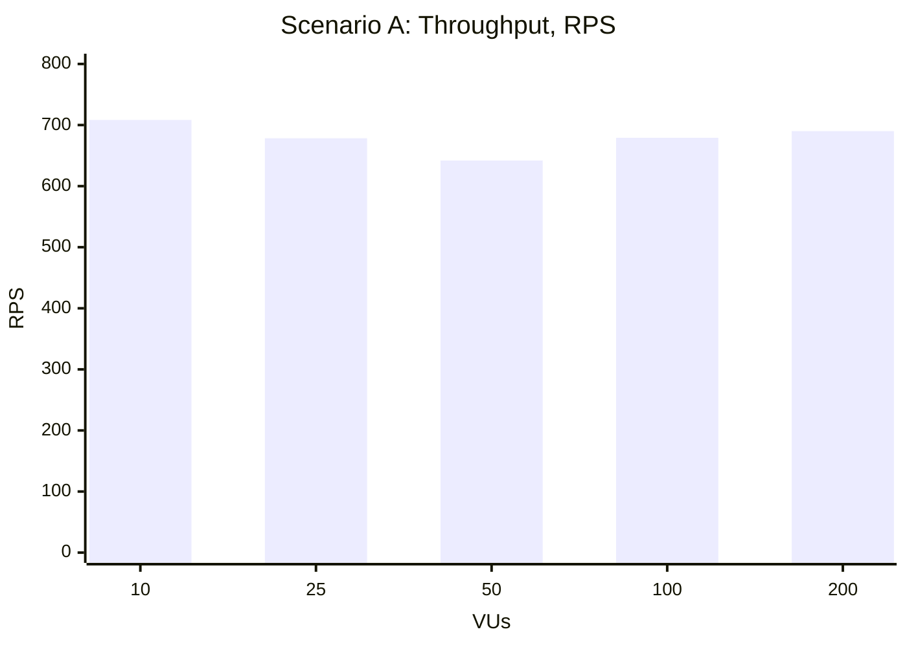
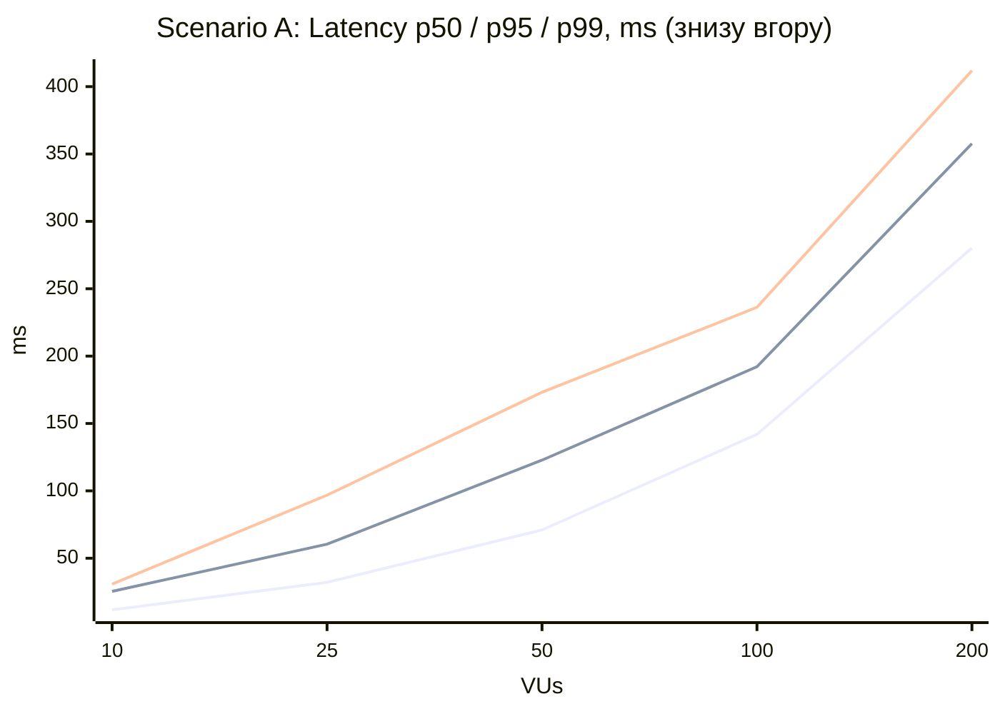
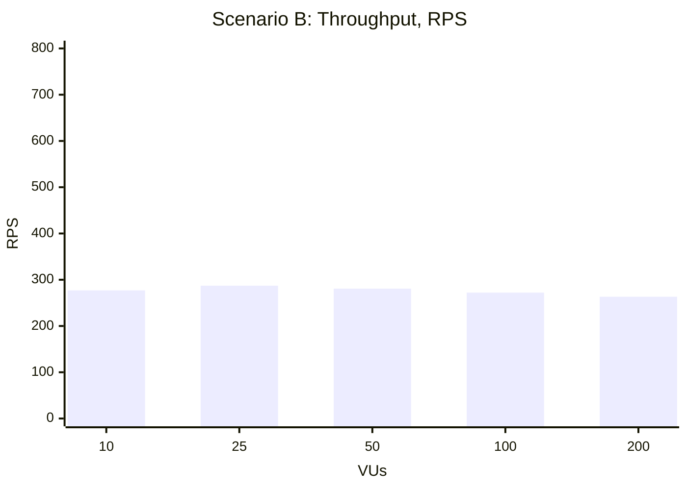
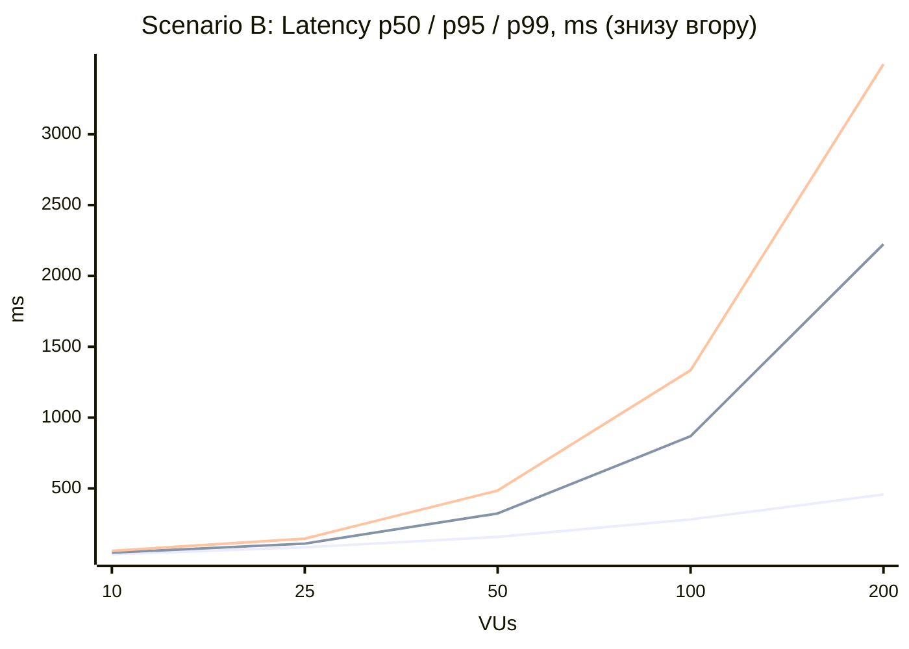
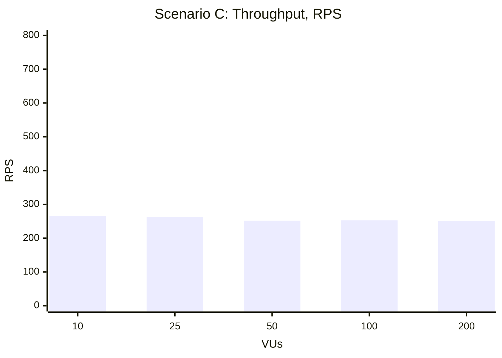
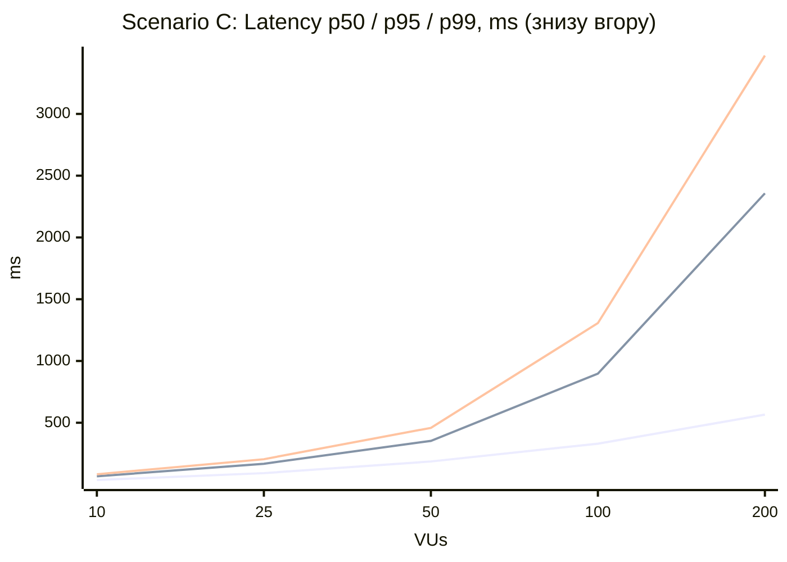
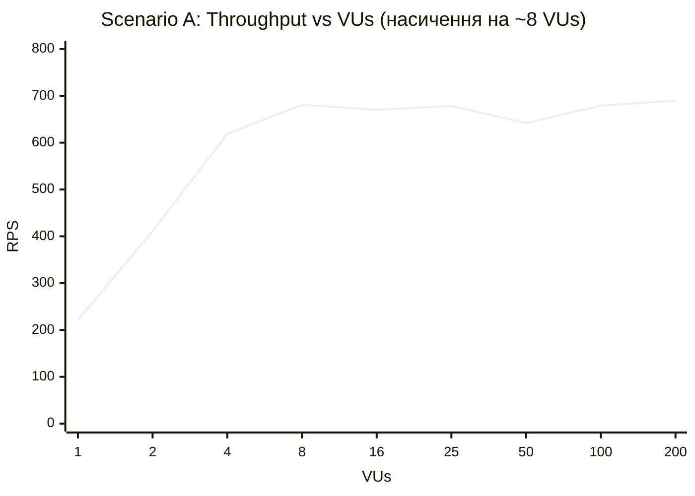
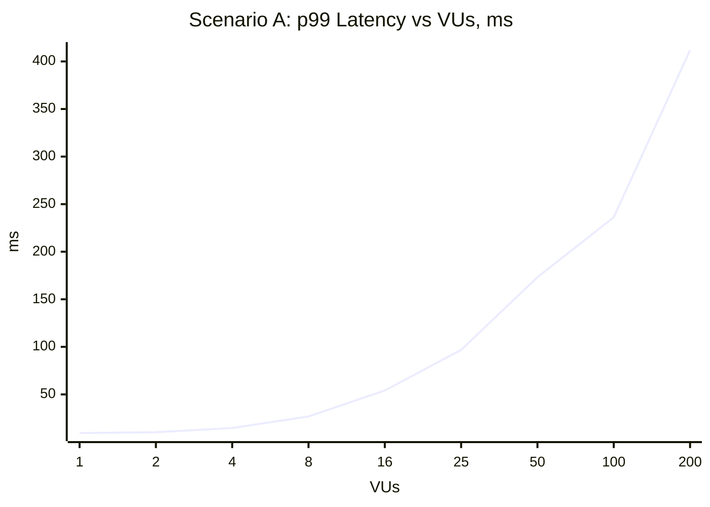
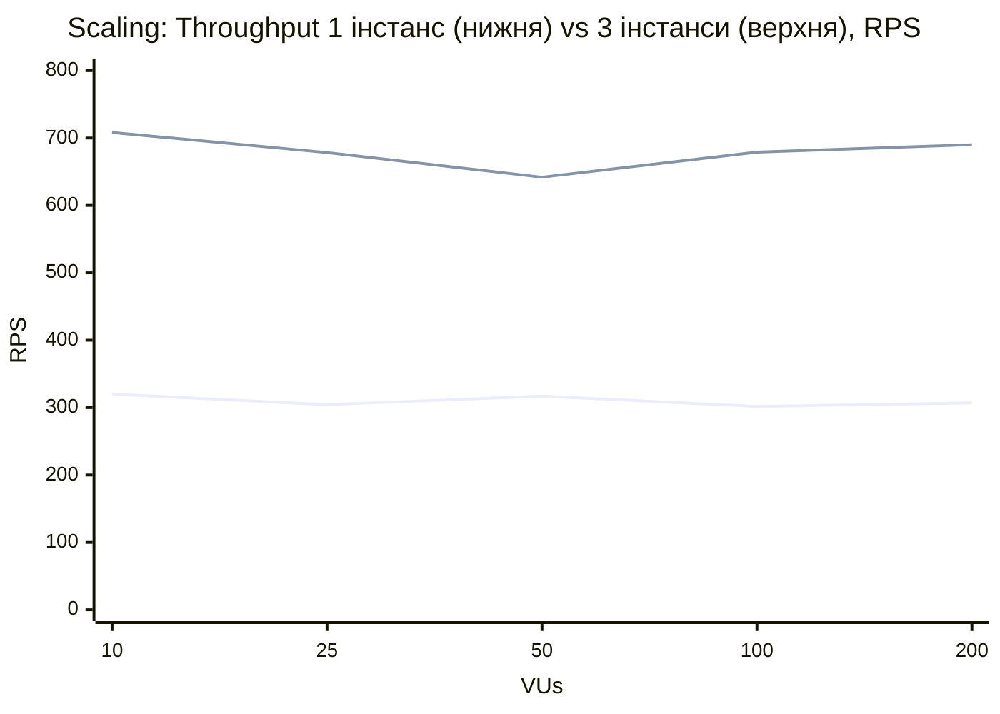
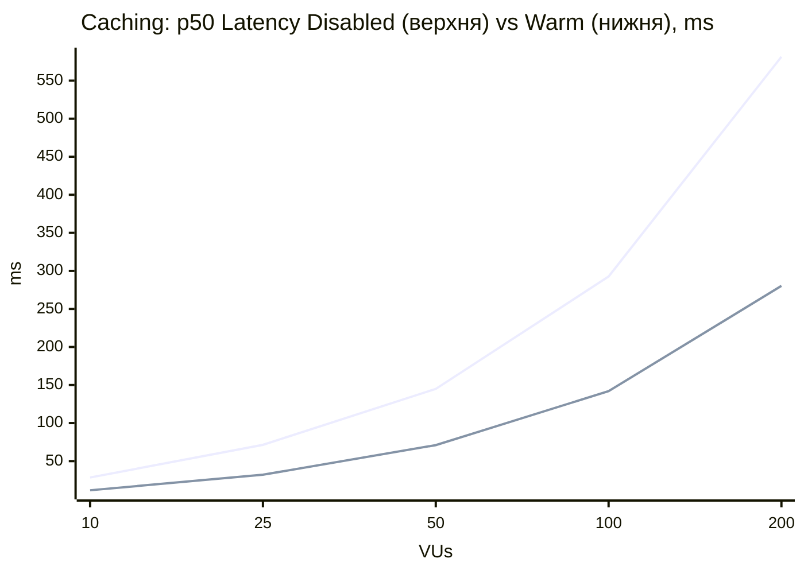

# Лабораторна робота № 5

**Тема:** Навантажувальне тестування (Load & Performance Baseline) та кількісний аналіз продуктивності системи
**Система:** Visual Inspiration Boards — Nginx (least_conn) + 3 stateless-інстанси FastAPI + PostgreSQL 16 + Redis 7 (Лабораторні роботи № 1–4)
**Інструмент:** [k6](https://k6.io) v2.2.0, скрипти в директорії [`load-tests/`](load-tests/)

---

## 1. Мета

Провести детерміновані навантажувальні дослідження системи та сформувати базовий профіль продуктивності (Performance Baseline). Для цього потрібно:
* виміряти Throughput, Latency (Avg/p50/p95/p99) та Error Rate для кожного сценарію і рівня навантаження;
* визначити точку насичення та первинне вузьке місце;
* кількісно оцінити ефект горизонтального масштабування (1 vs 3 інстанси) та кешування (Cache Disabled vs Warm Cache).

---

## 2. Як запустити тести 

### 2.1. Передумови

1. Встановлений **k6**: `winget install k6 --source winget` (або `choco install k6`). Перевірка: `k6 version`.
2. Встановлений і запущений **Docker Desktop**.
3. Усі команди виконуються з **кореня проєкту** (`visual_inspiration_boards`) у PowerShell.

### 2.2. Підняти систему

```powershell
docker compose up --build -d
curl.exe http://localhost:8080/health      # чекаємо "status":"healthy"
```

### 2.3. Повна серія тестів однією командою (~15 хв)

```powershell
powershell -ExecutionPolicy Bypass -File load-tests\run_all.ps1
```

Скрипт [`load-tests/run_all.ps1`](load-tests/run_all.ps1) по черзі виконує:
1. Scenario A, B, C на 3 інстансах з кешем;
2. Scenario A на 1 інстансі (зупиняє `backend-2`, `backend-3`, потім запускає їх знову);
3. Scenario A з вимкненим кешем (`REDIS_ENABLED=false`), після чого повертає кеш.

Перед кожним тестом кеш очищується (`FLUSHALL`). Під час ступенів 100/200 VUs знімається `docker stats`, а після тесту — кількість транзакцій PostgreSQL.

### 2.4. Запуск окремого сценарію

```powershell
k6 run -e NAME=A_read_3inst     load-tests\scenario_a_read.js       # Scenario A — Read-Intensive
k6 run -e NAME=B_write_3inst    load-tests\scenario_b_write.js      # Scenario B — Write-Intensive
k6 run -e NAME=C_workflow_3inst load-tests\scenario_c_workflow.js   # Scenario C — Complex Workflow
```

Під час виконання k6 показує в консолі живий прогрес: активний ступінь (`warmup`, `vu_10`, `vu_25`, …) і кількість VUs. Після завершення в консоль виводиться підсумкова таблиця.

**Параметри** (передаються через `-e`):

| Параметр | За замовчуванням | Призначення |
|---|---|---|
| `NAME` | `result` | Назва прогону, тобто ім'я файлів результатів |
| `LEVELS` | `10,25,50,100,200` | Ступені навантаження (VUs) |
| `STAGE_SEC` | `30` | Тривалість одного ступеня, с |
| `WARMUP_SEC` | `15` | Тривалість розігріву, с |
| `BASE_URL` | `http://localhost:8080` | Адреса системи (Nginx) |

Приклади:
```powershell
# пошук точки насичення на малих рівнях навантаження
k6 run -e NAME=A_low -e LEVELS=1,2,4,8,16 -e STAGE_SEC=20 load-tests\scenario_a_read.js
# швидка перевірка на захисті (~1 хв)
k6 run -e NAME=demo -e LEVELS=10,50,200 -e STAGE_SEC=15 load-tests\scenario_a_read.js
```

### 2.5. Порівняльні режими вручну

```powershell
# --- Scaling: 1 інстанс ---
docker compose stop backend-2 backend-3
k6 run -e NAME=A_read_1inst load-tests\scenario_a_read.js
docker compose start backend-2 backend-3            # повернути 3 інстанси

# --- Caching: Cold Cache (очистити Redis перед тестом) ---
docker exec vib_redis redis-cli FLUSHALL

# --- Caching: Cache Disabled ---
$env:REDIS_ENABLED="false"; docker compose up -d backend-1 backend-2 backend-3
k6 run -e NAME=A_read_3inst_nocache load-tests\scenario_a_read.js
Remove-Item Env:REDIS_ENABLED; docker compose up -d backend-1 backend-2 backend-3   # кеш знову увімкнено
```

### 2.6. Моніторинг SUT під час тесту (у другому терміналі)

```powershell
docker stats                                                                          # CPU/RAM контейнерів
docker exec vib_postgres psql -U postgres -tAc "select count(*) from pg_stat_activity"   # з'єднання з БД
docker exec vib_postgres psql -U postgres -d visual_boards -tAc "select xact_commit from pg_stat_database where datname='visual_boards'"  # транзакції БД
```

### 2.7. Де результати

| Файл | Вміст |
|---|---|
| `load-tests/results/<NAME>.md` | Таблиця метрик по ступенях + графіки (Mermaid) |
| `load-tests/results/<NAME>.json` | Ті самі дані в JSON |
| `load-tests/results/env_log.txt` | `docker stats`, з'єднання й транзакції БД (лише при `run_all.ps1`) |

---

## 3. Сценарії навантаження

| Сценарій | Тип навантаження | Опис сценарію | Ресурсний профіль |
|---|---|---|---|
| **Scenario A** ([`scenario_a_read.js`](load-tests/scenario_a_read.js)) | Read-Intensive | Перегляд дощок: 80% — `GET /boards/{id}` (деталі дошки з елементами та співавторами, Cache-Aside), 20% — `GET /boards` (список з агрегацією `elements_count`) | Високе навантаження на Cache Layer (Redis), CPU бекенду (JSON-серіалізація), читання з PostgreSQL для MISS і списку |
| **Scenario B** ([`scenario_b_write.js`](load-tests/scenario_b_write.js)) | Write-Intensive | Спільне редагування: `POST /boards/{id}/elements` (новий елемент), потім `PUT /elements/{id}` (переміщення). Усі VUs пишуть у 5 спільних дощок | INSERT/UPDATE, commit + WAL, інкремент `board.version` створює row-lock на рядку дошки (Lock Contention), інвалідація кешу |
| **Scenario C** ([`scenario_c_workflow.js`](load-tests/scenario_c_workflow.js)) | Complex Workflow | Повний життєвий цикл дошки: create board → 3 elements → GET (MISS) → GET (HIT) → PATCH з `expected_version` (optimistic lock) → export → delete. 9 запитів за ітерацію | Змішані read/write, багато коротких транзакцій, каскадне видалення, серіалізація великого JSON (export), Cache MISS → HIT → інвалідація |

**Модель навантаження.** Закрита модель (closed model, executor `constant-vus`): кожен VU надсилає наступний запит одразу після відповіді, без `sleep`. Тож N VUs — це рівно N одночасних запитів у системі.

---

## 4. Конфігурація тестового середовища (Baseline Environment Specification)

| Параметр | Значення |
|---|---|
| Хост | Windows 11 Pro, 16 логічних CPU; Docker Desktop 29.4 (WSL2, 7.47 GiB RAM для Docker) |
| Backend instances | 3 × FastAPI/uvicorn (1 процес) — **ліміт 1 CPU, 512 MB RAM** кожен (`cpus`, `mem_limit` у `docker-compose.yml`) |
| Балансувальник | Nginx 1.28, `least_conn`, `proxy_read_timeout 30s` |
| PostgreSQL | 16-alpine, **ліміт 2 CPU, 1 GB RAM**, `max_connections = 100` |
| Connection Pool (SQLAlchemy) | На інстанс: `pool_size=5` + `max_overflow=10` = до 15 з'єднань, `pool_timeout=30s`, `pool_pre_ping=True` → до 45 з'єднань на 3 інстанси |
| Redis | 7-alpine, `maxmemory 64mb`, `allkeys-lru`, без persistence; Cache-Aside, TTL 300 с; стан перед кожним тестом — порожній (`FLUSHALL`), прогрівається у фазі warm-up |
| Load Generator | k6 v2.2.0, запущений на хості поза Docker |

**Ізоляція генератора навантаження та SUT.** Усі компоненти SUT обмежені сумарно 6 CPU: 3 backend по 1 + PostgreSQL 2, плюс Nginx і Redis без ліміту, але вони використовують < 0.4 ядра. k6 працює поза контейнерами і має решту ~10 ядер хоста, тож генератор не конкурує з SUT за CPU. Обмеження: обидва працюють на одній фізичній машині, тому мережевий стек і пам'ять спільні. Для повної ізоляції k6 слід запускати на окремій машині (`-e BASE_URL=http://<host>:8080`).

---

## 5. Профіль навантаження: Warm-up та Staging Ramp-Up

Профіль задається у [`load-tests/lib.js`](load-tests/lib.js) (функція `buildOptions`):

```text
VUs
200 |                                              ┌────────┐
100 |                                     ┌────────┘        │
 50 |                            ┌────────┘                 │
 25 |                   ┌────────┘                          │
 10 |          ┌────────┘                                   │
  5 | ┌────────┘ warm-up (не входить у звіт)                │
    └─0s──────15s──────45s──────75s──────105s─────135s─────165s──►
```

* **Warm-up (15 с, 5 VUs):** відкриття з'єднань у пулах SQLAlchemy і Redis, keepalive між Nginx і клієнтом, DNS-резолв, наповнення кешу, «прогрів» інтерпретатора. Метрики цієї фази у таблиці не потрапляють.
* **Staging:** 10 → 25 → 50 → 100 → 200 VUs по 30 с. Кожен ступінь — окремий k6-scenario (`vu_10`, `vu_25`, …). Тому k6 рахує метрики для кожного ступеня окремо (sub-метрики за тегом `scenario`), а `gracefulStop: 0s` не дає хвосту попереднього ступеня спотворити наступний.
* **Throughput** ступеня = кількість запитів / 30 с. Перцентилі рахує сам k6 (`summaryTrendStats: avg, med, p(95), p(99)`).
* Звіт формує `handleSummary` у файли `results/<NAME>.md` (таблиця + графіки) і `results/<NAME>.json`.

---

## 6. Результати вимірювань (3 інстанси, кеш увімкнено)

### 6.1. Scenario A — Read-Intensive

| Навантаження (VUs) | Throughput (RPS) | Avg Latency, ms | p50 Latency, ms | p95 Latency, ms | p99 Latency (Tail), ms | Error Rate, % |
|---|---|---|---|---|---|---|
| 10 | 708.3 | 13.9 | 11.7 | 25.4 | 30.8 | 0.00 |
| 25 | 678.4 | 36.6 | 32.1 | 60.4 | 96.8 | 0.00 |
| 50 | 641.9 | 77.6 | 71.0 | 122.8 | 173.2 | 0.00 |
| 100 | 679.1 | 146.7 | 141.9 | 192.1 | 236.2 | 0.00 |
| 200 | 690.1 | 287.9 | 280.3 | 357.7 | 411.9 | 0.00 |





### 6.2. Scenario B — Write-Intensive

| Навантаження (VUs) | Throughput (RPS) | Avg Latency, ms | p50 Latency, ms | p95 Latency, ms | p99 Latency (Tail), ms | Error Rate, % |
|---|---|---|---|---|---|---|
| 10 | 276.9 | 35.9 | 34.9 | 46.6 | 59.6 | 0.00 |
| 25 | 287.2 | 86.7 | 84.3 | 110.5 | 145.6 | 0.00 |
| 50 | 280.8 | 177.2 | 158.3 | 323.2 | 485.3 | 0.00 |
| 100 | 272.1 | 363.4 | 281.2 | 868.9 | 1334.4 | 0.00 |
| 200 | 263.3 | 737.9 | 457.6 | 2223.9 | 3494.7 | 0.00 |





### 6.3. Scenario C — Complex Workflow

| Навантаження (VUs) | Throughput (RPS) | Avg Latency, ms | p50 Latency, ms | p95 Latency, ms | p99 Latency (Tail), ms | Error Rate, % |
|---|---|---|---|---|---|---|
| 10 | 265.6 | 37.4 | 36.4 | 66.4 | 83.0 | 0.00 |
| 25 | 262.0 | 95.1 | 92.1 | 168.0 | 204.8 | 0.00 |
| 50 | 251.5 | 197.7 | 186.6 | 353.1 | 458.4 | 0.00 |
| 100 | 252.9 | 391.5 | 330.2 | 897.5 | 1306.5 | 0.00 |
| 200 | 251.1 | 776.0 | 565.6 | 2357.2 | 3472.4 | 0.00 |





### 6.4. Завантаження ресурсів на ступенях 100–200 VUs (`docker stats`)

| Сценарій | backend-1/2/3, CPU | PostgreSQL, CPU | Redis, CPU | Nginx, CPU | З'єднань з БД |
|---|---|---|---|---|---|
| A (Read) | 100% / 100% / 100% | 22% | 6.5% | 38% | 22 |
| B (Write) | 99% / 99% / 99% | 75% | 3% | 14% | 51 |
| C (Workflow) | 100% / 99% / 100% | 59% | 3% | 13% | 51 |

100% = одне ядро, тобто ліміт `cpus: 1` кожного бекенду. 51 з'єднання = 45 (3 пули × 15, вичерпані повністю) + службові процеси PostgreSQL.

---

## 7. Аналіз: середнє значення vs хвостові перцентилі

**Read (A):** p99 перевищує p50 лише в 1.5–3 рази (200 VUs: 280 мс проти 412 мс). Розподіл затримок вузький, бо всі запити майже однакові: HIT у Redis + серіалізація JSON. Затримка росте лінійно з VUs через чергу на CPU бекенду. Це підтверджує **закон Літтла**: `L = λ·W` → `W = 200 / 690 RPS ≈ 290 мс`, що збігається з виміряним Avg = 288 мс. Отже, затримка — це майже повністю час очікування в черзі.

**Write (B) та Workflow (C):** середнє значення приховує проблему.
* На 200 VUs у B p50 = 458 мс, а p99 = 3495 мс — у **7.6 раза** більше.
* Avg (738 мс) значно вищий за p50, тобто розподіл має «важкий хвіст».
* Поки p50 зростає ~лінійно (×13 від 10 до 200 VUs), p99 зростає **×59**.

**Причини нелінійного зростання tail latency:**
1. **Lock Contention.** Кожне створення/зміна елемента виконує `board.version += 1` — UPDATE того самого рядка `boards`. Усі VUs пишуть у 5 спільних дощок, тож транзакції стають у чергу за row-lock. Кілька «невдах» чекають на завершення багатьох попередніх транзакцій, тому їхні затримки і формують p99.
2. **Вичерпання Connection Pool.** На 3 інстанси лише 45 з'єднань, а одночасних запитів — до 200. Запит, який отримав з'єднання, обслуговується швидко, а решта чекає в черзі пулу (`pool_timeout=30s`). Якщо запит потрапив у чергу саме тоді, коли з'єднання утримують довгі транзакції, що чекають на row-lock (п. 1), його очікування додається до їхнього — так ефекти 1 і 2 підсилюють один одного.
3. **Конкуренція за CPU бекенду.** Один процес uvicorn на ядро: asyncio-цикл перемикається між сотнями корутин, і запит, що вже отримав відповідь від БД, чекає, доки цикл дійде до нього.
4. **Збирання сміття (GC) у Python.** Під навантаженням створюється багато об'єктів (ORM-моделі, dict для JSON). Пауза GC зупиняє на кілька мілісекунд усі запити процесу одразу, і це помітно саме в p99.

**Висновок:** для SLA треба орієнтуватися на p95/p99, а не на Avg. При Avg = 738 мс кожен сотий користувач чекає 3.5 с.

---

## 8. Точка насичення (Saturation Point)

Щоб знайти «коліно» кривої, проведено додаткові прогони на малих рівнях навантаження (`LEVELS=1,2,4,8,16`, `STAGE_SEC=20`):

| VUs | A: RPS | A: p50, ms | A: p99, ms | B: RPS | B: p50, ms | B: p99, ms |
|---|---|---|---|---|---|---|
| 1 | 221.1 | 3.6 | 9.4 | 81.7 | 12.0 | 17.2 |
| 2 | 411.1 | 3.8 | 10.3 | 155.3 | 12.5 | 19.0 |
| 4 | 618.8 | 5.0 | 14.7 | 232.1 | 16.7 | 27.6 |
| **8** | **680.8** | 9.6 | 26.8 | **272.0** | 28.6 | 41.7 |
| 16 | 670.4 | 20.0 | 54.1 | 268.9 | 57.8 | 99.5 |





**Інтерпретація:**
* **1 → 4 VUs:** throughput росте майже лінійно (221 → 411 → 619 RPS), латентність майже не змінюється. Система має вільні ресурси.
* **4 → 8 VUs:** приріст throughput лише +10%, а p50 подвоюється. Це «коліно».
* **8+ VUs:** throughput стоїть на плато ~680 RPS (A) / ~272 RPS (B). Кожне подвоєння VUs подвоює затримку, а для запису p99 росте ще швидше.

**Saturation Point:** **~8 VUs (≈ 680 RPS)** для читання та **~8 VUs (≈ 272 RPS)** для запису.

**Error Rate.** Навіть на 200 VUs помилок немає (0.00%). Причина в закритій моделі навантаження: максимум одночасних запитів дорівнює кількості VUs (200). Вони вміщаються в черги Nginx, uvicorn і пулу з'єднань без досягнення таймаутів (`pool_timeout=30s`, `proxy_read_timeout=30s`). Тож перевантаження проявляється **деградацією затримки**, а не відмовами. Помилки з'явилися б, якби p99 наблизився до 30 с, або при відкритій моделі (`constant-arrival-rate`) з цільовим RPS вище за 680, коли черга росте необмежено.

---

## 9. Первинне вузьке місце (Primary Bottleneck)

**Первинне вузьке місце — CPU backend-інстансів (CPU-bound Python worker).**
* На всіх сценаріях після точки насичення кожен бекенд завантажений на 99–100% свого ліміту (1 ядро).
* PostgreSQL використовує лише 22–75% із 2 доступних ядер, Redis — до 6.5%, Nginx — до 38%.
* Один процес uvicorn виконує Python-код в одному потоці (GIL). Тому серіалізація JSON (Pydantic), ORM-маппінг і обробка HTTP обмежені одним ядром на інстанс.
* Це підтверджує Scaling-експеримент (розділ 10.1): додавання інстансів збільшує throughput.

**Вторинні обмеження для запису (B, C), що формують хвіст затримок:**
* **Lock Contention** на рядку `boards` (інкремент `version` при кожній зміні елемента);
* **Вичерпання DB Connection Pool**: 45 з 45 з'єднань зайняті (51 з урахуванням службових). При масштабуванні понад ~6 інстансів (6 × 15 = 90) упираємось у `max_connections=100` PostgreSQL.

**Шляхи розв'язання:**
* кілька воркерів uvicorn на інстанс (`--workers N`) або більше інстансів;
* PgBouncer перед PostgreSQL;
* заміна `board.version += 1` при кожній зміні елемента на версіонування самих елементів, щоб прибрати «гарячий рядок».

---

## 10. Контрольні експерименти

### 10.1. Scaling Impact Analysis (Scenario A: 1 vs 3 інстанси)

Однакові умови: той самий сценарій і профіль, кеш увімкнено та прогрітий у warm-up, ліміт 1 CPU на інстанс.

| VUs | 1 інстанс: RPS | 3 інстанси: RPS | Приріст | 1 інстанс: p50 / p99, ms | 3 інстанси: p50 / p99, ms |
|---|---|---|---|---|---|
| 10 | 320.1 | 708.3 | ×2.21 | 27.4 / 82.1 | 11.7 / 30.8 |
| 25 | 304.4 | 678.4 | ×2.23 | 78.4 / 140.8 | 32.1 / 96.8 |
| 50 | 317.0 | 641.9 | ×2.02 | 153.4 / 221.6 | 71.0 / 173.2 |
| 100 | 301.8 | 679.1 | ×2.25 | 323.4 / 433.2 | 141.9 / 236.2 |
| 200 | 307.0 | 690.1 | ×2.25 | 640.2 / 804.6 | 280.3 / 411.9 |



**Scalability Efficiency Factor:**

```text
Speedup    S = RPS(3) / RPS(1) = 690.1 / 307.0 ≈ 2.25        (на 200 VUs; середнє по ступенях ≈ 2.19)
Efficiency E = S / N = 2.25 / 3 ≈ 0.75  →  75%
```

Масштабування сублінійне: 75% замість ідеальних 100%. Причини:
* спільні компоненти (Nginx, PostgreSQL, Redis, мережа Docker) обробляють сумарний трафік усіх вузлів, і їхня частка в часі відповіді стає помітнішою (закон Амдала);
* 20% запитів (`GET /boards`) завжди йдуть у БД;
* навантаження на Nginx зросло з 15% до 38% CPU.

Для запитів, обмежених CPU бекенду, горизонтальне масштабування залишається ефективним.

### 10.2. Caching Impact Analysis (Scenario A: Cache Disabled vs Warm Cache)

* **Cache Disabled:** `REDIS_ENABLED=false` на всіх інстансах, кожен `GET /boards/{id}` виконує 4 SQL-запити.
* **Warm Cache:** кеш прогрівається у фазі warm-up, далі `GET /boards/{id}` — HIT з Redis.
* **Cold Cache** (порожній Redis після `FLUSHALL`) у Cache-Aside живе дуже коротко: кожна з дощок дає лише один MISS, після чого стає HIT. Тому в стаціонарному режимі Cold Cache зводиться до Warm Cache, а «найгірший випадок» — це Cache Disabled.

| VUs | Cache Disabled: RPS | Warm Cache: RPS | Приріст | Disabled: p50 / p99, ms | Warm: p50 / p99, ms |
|---|---|---|---|---|---|
| 10 | 338.7 | 708.3 | ×2.09 | 28.5 / 46.6 | 11.7 / 30.8 |
| 25 | 338.0 | 678.4 | ×2.01 | 71.4 / 134.7 | 32.1 / 96.8 |
| 50 | 337.7 | 641.9 | ×1.90 | 144.9 / 213.5 | 71.0 / 173.2 |
| 100 | 334.0 | 679.1 | ×2.03 | 292.6 / 385.9 | 141.9 / 236.2 |
| 200 | 335.8 | 690.1 | ×2.06 | 581.4 / 709.9 | 280.3 / 411.9 |



**Зниження навантаження на СУБД** (транзакції PostgreSQL за весь прогін, `pg_stat_database`; кількість HTTP-запитів ≈ сума RPS × 30 с):

| Режим | HTTP-запитів | Транзакцій БД | Транзакцій на запит | CPU PostgreSQL | З'єднань з БД |
|---|---|---|---|---|---|
| Cache Disabled | ≈ 50 500 | 111 829 | ≈ 2.2 | 49% | 51 (пул вичерпано) |
| Warm Cache | ≈ 102 000 | 45 155 | ≈ 0.44 | 22% | 22 |

**Висновки:**
* Кеш **подвоїв throughput** (336 → 690 RPS) та вдвічі знизив p50 на всіх ступенях.
* Навантаження на БД у перерахунку на один запит зменшилось у **~5 разів**: залишились лише 20% запитів списку та поодинокі MISS.
* Пул з'єднань більше не вичерпується (22 з'єднання замість 51).
* В обох режимах вузьким місцем залишається CPU бекенду (100%). Кеш прибрав очікування на БД, але JSON-серіалізація відповіді виконується й при HIT.

---

## 11. System Performance Baseline

```text
=== SYSTEM PERFORMANCE BASELINE ===
Environment Config: Nginx 1.28 (least_conn) + 3 × FastAPI/uvicorn (1 CPU, 512 MB each);
                    PostgreSQL 16 (2 CPU, 1 GB, max_connections=100);
                    SQLAlchemy pool 5+10 per instance (45 total), pool_timeout 30 s;
                    Redis 7 (64 MB, allkeys-lru, Cache-Aside TTL 300 s, warm);
                    k6 2.2.0 on host (Win 11, 16 CPU), closed model, warm-up 15 s
Stable Throughput:  ~680 RPS read (Scenario A) / ~270 RPS write (Scenario B)
                    at p95 < 100 ms (A: up to 25 VUs, B: up to 16 VUs)
Saturation Point:   ~8 VUs (≈ 680 RPS read, ≈ 272 RPS write); beyond it RPS is flat,
                    latency grows linearly with VUs (Little's Law)
p95 / p99 Latency:  A @ 8 VUs: 22.4 / 26.8 ms;  B @ 8 VUs: 36.1 / 41.7 ms
                    (A @ 200 VUs: 357.7 / 411.9 ms;  B @ 200 VUs: 2223.9 / 3494.7 ms)
Error Rate:         0.00% at saturation and up to 200 VUs (degradation = latency, not errors)
Critical Scenario:  Scenario C — Complex Workflow (lowest RPS 251, p99 3.47 s @ 200 VUs);
                    Scenario B — Write-Intensive has the same tail (p99 3.49 s)
Primary Bottleneck: Backend CPU (1 uvicorn process = 1 core, 100% utilization);
                    secondary for writes: row-lock contention on boards.version
                    + DB connection pool exhaustion (45/45)
```

---

## 12. Теоретичні питання

**Saturation Point (точка насичення).** Рівень навантаження, за якого найповільніший ресурс системи (тут CPU бекенду) завантажений на 100%. До цієї точки додаткові користувачі збільшують throughput майже лінійно. Після неї throughput виходить на плато, а кожен новий запит лише подовжує чергу: за законом Літтла `W = L / λ`, при сталому λ затримка росте пропорційно кількості одночасних запитів L. В експерименті це ~8 VUs: між 4 і 8 VUs throughput зріс лише на 10%, а p50 подвоївся.

**Coordinated Omission (координаційна омана).** Похибка вимірювання в закритій моделі навантаження. Коли система «зависає», генератор теж перестає надсилати нові запити, бо кожен VU чекає на відповідь. Запити, які реальні користувачі надіслали б за цей час, просто не потрапляють у вибірку, тому перцентилі виглядають кращими, ніж є насправді.
* У цій роботі використано `constant-vus` (закрита модель), тож p99 є **оцінкою знизу**.
* На плато throughput не росте саме тому, що генератор «підлаштовується» під швидкість системи.
* Щоб уникнути омани, потрібна відкрита модель з фіксованою частотою запитів (k6 `constant-arrival-rate` / `ramping-arrival-rate`). Тоді затримка рахується від запланованого моменту відправки, а після точки насичення черга і p99 ростуть необмежено, з'являються таймаути й помилки.

**Вплив GC/JIT на перцентилі.**
* **Garbage Collection.** Пауза GC (у Python — циклічний збирач поколінь; у JVM/.NET — stop-the-world фази) зупиняє обробку всіх запитів процесу одночасно. Пауза рідкісна, тому майже не впливає на Avg/p50, але повністю потрапляє в p99/p99.9. Чим більше об'єктів створюється під навантаженням (ORM, JSON), тим частіші паузи.
* **JIT/Runtime warm-up.** Перші запити повільніші: компіляція байткоду, ліниве імпортування модулів, відкриття з'єднань у пулах, холодні кеші CPU і Redis. Саме тому перед вимірюваннями виконується фаза **warm-up**, а її метрики виключені з таблиць. Інакше перші секунди штучно «роздули» б хвіст розподілу.

---

## 13. Висновок

1. Розроблено три автоматизовані k6-сценарії (Read-Intensive, Write-Intensive, Complex Workflow) зі спільним профілем навантаження «warm-up + staging 10 → 25 → 50 → 100 → 200 VUs». Таблиці й графіки по кожному ступеню генеруються автоматично (`handleSummary`), а вся серія відтворюється однією командою (`run_all.ps1`).
2. Середовище зафіксоване декларативно: ліміти CPU/RAM у `docker-compose.yml`, пули з'єднань, конфігурація Redis. Генератор навантаження працює поза лімітованими контейнерами SUT.
3. **Точка насичення ~8 VUs:**
   * читання ≈ 680 RPS, запис ≈ 272 RPS;
   * далі throughput стоїть на плато, а затримка росте лінійно з кількістю VUs, що точно відповідає закону Літтла;
   * помилок немає до 200 VUs: перевантаження проявляється через латентність.
4. **Хвостові затримки:** для читання p99 ≈ 1.5 × p50, а для запису до 7.6 × p50 (3.5 с проти 0.46 с) через конкуренцію за row-lock рядка дошки та вичерпання пулу з'єднань. Avg приховує цю проблему, тож SLA слід формулювати через p95/p99.
5. **Первинне вузьке місце — CPU backend-інстансів** (1 процес Python = 1 ядро, 100%). PostgreSQL і Redis мають запас.
6. **Масштабування 1 → 3 інстанси:** throughput ×2.25, Scalability Efficiency ≈ 75%. Ефективність обмежують спільні компоненти (закон Амдала).
7. **Кешування:** throughput ×2.05, p50 у 2 рази нижчий, кількість транзакцій БД на запит у ~5 разів менша, пул з'єднань більше не вичерпується.
