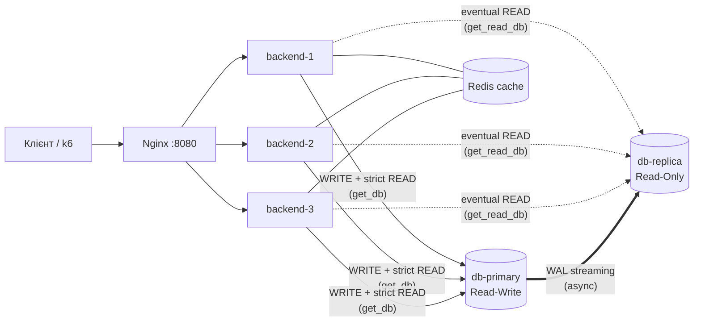

# Лабораторна робота № 6

**Тема:** Реплікація баз даних (Database Replication) та розділення читання і запису (Read/Write Separation)
**Система:** Visual Inspiration Boards: Nginx + 3 stateless-бекенди FastAPI + Redis + **PostgreSQL 16 Primary → Replica** (Лабораторні роботи № 1–5)

---

## 0. Архітектура (що змінилося)

Раніше в системі була одна база `postgres`. Тепер баз дві:

* **`db-primary`** (контейнер `database_primary`) приймає всі записи та критичні читання;
* **`db-replica`** (контейнер `database_replica`) — копія тільки для читання. Вона постійно отримує з Primary журнал змін (WAL) і застосовує його в себе.



Як ходять запити:
* **Запис** (POST/PATCH/DELETE) → завжди Primary.
* **Eventual-читання** → Replica. Якщо Replica недоступна, читання йде на Primary.
* **Strict-читання** → завжди Primary.
* **Після запису** клієнт отримує cookie `rw_sticky` на 5 с. Поки вона діє, навіть eventual-читання цього клієнта йдуть на Primary.

---

## 2.1. Топологія реплікації (Primary / Replica)

**Що зроблено** ([`docker-compose.yml`](docker-compose.yml), [`docker/postgres/`](docker/postgres/)):

| Що | Де | Навіщо |
|---|---|---|
| `wal_level=replica`, `max_wal_senders=5`, `wal_keep_size=256MB` | `db-primary → command` | Primary пише в WAL усе, що потрібно репліці, і віддає його через «WAL sender» |
| користувач `replicator` з правом `REPLICATION` | [`primary-init.sql`](docker/postgres/primary-init.sql) | окремий обліковий запис для підключення репліки |
| `host replication replicator all scram-sha-256` | [`pg_hba.conf`](docker/postgres/pg_hba.conf) | дозвіл на replication-з'єднання |
| `pg_basebackup -h db-primary ... -R` | `db-replica → entrypoint` | при першому старті репліка копіює всі дані з Primary. Прапорець `-R` вмикає режим standby (Read-Only) і записує адресу Primary |
| `hot_standby=on` | `db-replica` | на репліці можна виконувати SELECT |

Реплікація **асинхронна**: Primary підтверджує COMMIT одразу, не чекаючи репліку (`sync_state = async`).

**Перевірка (реальний вивід):**

```powershell
docker exec database_primary psql -U postgres -d visual_boards -c "CREATE TABLE IF NOT EXISTS replication_check(id serial primary key, note text, created_at timestamptz default now());" -c "INSERT INTO replication_check(note) VALUES ('hello from primary');"
docker exec database_replica psql -U postgres -d visual_boards -c "SELECT * FROM replication_check;" -c "SELECT pg_is_in_recovery();"
docker exec database_replica psql -U postgres -d visual_boards -c "INSERT INTO replication_check(note) VALUES ('x');"
```
```
 id |        note        |          created_at
  1 | hello from primary | 2026-11-02 12:23:14.599179+00     <- рядок з'явився на репліці
 pg_is_in_recovery = t                                        <- вузол працює як репліка
ERROR:  cannot execute INSERT in a read-only transaction       <- писати в репліку не можна
```

Стан реплікації можна подивитися через API: `GET /api/v1/lab/replication`
```json
{"primary":{"wal_lsn":"0/80235D0","replicas":[{"client_addr":"172.20.0.4/32","state":"streaming",
  "sync_state":"async","lag_bytes":0,"replay_lag":"00:00:00.002922"}]},
 "replica":{"in_recovery":true,"replayed_lsn":"0/80235D0", ...}}
```
`wal_lsn` на Primary і `replayed_lsn` на Replica збігаються, отже репліка повністю синхронізована.

---

## 2.2. Read/Write Separation

**Спосіб:** програмний, **Multi-Pool Manager** у шарі доступу до даних, файл [`app/core/database.py`](app/core/database.py).

У застосунку два пули з'єднань SQLAlchemy (`primary` і `replica`) і дві FastAPI-залежності:

```python
async def get_db(...):        # Primary: записи + strict-читання
async def get_read_db(...):   # Replica: eventual-читання (з fallback на Primary)
```

Кожен ендпоінт сам вказує, яка залежність йому потрібна:
```python
db: AsyncSession = Depends(get_read_db)  # Lab 6: Eventual — публічний каталог, читаємо з Replica
```

Кожна відповідь містить заголовок **`X-DB-Node: primary | replica`**, тож видно, який вузол БД обслужив запит:
```powershell
curl.exe -s -D - -o NUL http://localhost:8080/api/v1/boards     # x-db-node: replica
curl.exe -s -D - -o NUL http://localhost:8080/api/v1/users/1    # x-db-node: primary
```

---

## 2.3. Класифікація читань і Replication Lag

### Класифікація бізнес-операцій

| Операція | Тип | Вузол | Чому |
|---|---|---|---|
| `GET /boards` — каталог дощок | Eventual | Replica | публічний список, затримка в частку секунди нікому не шкодить |
| `GET /boards/{id}/export` — експорт/звіт | Eventual | Replica | аналітичний знімок |
| `GET /users` — список користувачів | Eventual | Replica | публічний список |
| `GET /users/{id}` — профіль (аналог автентифікації) | **Strict** | Primary | дані акаунта мають бути точними |
| `GET /boards/{id}` — редактор дошки | **Strict** | Primary (+Redis) | потрібна свіжа `version` для Optimistic Locking, інакше будуть хибні 409 Conflict. Навантаження все одно знімає кеш Redis (Lab 4) |
| `GET /boards/{id}/elements`, `/collaborators` | **Strict** | Primary | частина редактора / прав доступу |
| усі POST / PATCH / DELETE | Write | Primary | репліка Read-Only |

### Replication Lag і Stale Read

* **Природний лаг** у Docker на одній машині дуже малий: `replay_lag ≈ 0.003 с`, `lag_bytes = 0`.
* Щоб побачити Stale Read, лаг створено **синтетично** параметром репліки `recovery_min_apply_delay`: репліка отримує WAL одразу, але застосовує транзакцію лише через N секунд.

```powershell
$env:REPLICA_LAG="3s"; docker compose up -d db-replica      # увімкнути лаг 3 с
python scripts/replication_demo.py
```
**Результат** ([`scripts/replication_demo.py`](scripts/replication_demo.py)):
```
== 1. Stale Read (клієнт БЕЗ sticky-cookie)
   одразу після POST: знайдено=False  X-DB-Node=replica   <- STALE READ!
   дошка з'явилась на replica через ~3062 мс  (= Replication Lag)
```
Дошку щойно створено на Primary, але список з Replica її ще не показує. Через ~3 с вона з'являється. Це і є **Stale Read**.
Під час лагу `GET /api/v1/lab/replication` показує `"replay_lag":"00:00:01.92"`.

Без штучного лагу (`REPLICA_LAG=0`) той самий скрипт показує: `знайдено=True ... через ~73 мс`. Цей час включає POST і GET, тобто репліка встигає ще до наступного запиту.

---

## 2.4. Read-After-Write Consistency

Реалізовано два механізми.

**1. Session Sticky Routing** (основний), файли [`app/main.py`](app/main.py) і [`app/core/database.py`](app/core/database.py):
* після будь-якого успішного POST/PUT/PATCH/DELETE бекенд ставить cookie `rw_sticky` з `max_age = STICKY_TTL_SEC` (5 с);
* `get_read_db` бачить цю cookie і читає з **Primary**;
* через 5 с браузер сам видаляє cookie, і читання знову йдуть на Replica.

Стан зберігається у клієнта (у cookie), а не в пам'яті сервера. Тому механізм працює на будь-якому з 3 stateless-бекендів (вимога Lab 2).
TTL має бути більшим за типовий лаг. У нас TTL 5 с, а синтетичний лаг 3 с.

**2. Explicit Primary Routing**: критичні об'єкти (профіль `GET /users/{id}`, редактор дошки) завжди читаються з Primary через `Depends(get_db)`.

**Результат** (той самий скрипт, лаг 3 с):
```
== 2. Read-After-Write (клієнт ЗІ sticky-cookie)
   одразу після POST: знайдено=True  X-DB-Node=primary   <- cookie rw_sticky => читання з Primary
   чекаємо 6 с (STICKY_TTL_SEC=5), cookie зникає...
   після TTL:         знайдено=True  X-DB-Node=replica   <- знову читаємо з Replica
```
Автор бачить свою дошку одразу, хоча репліка відстає на 3 с.

---

## 2.5. Відмовостійкість (Fault Tolerance)

Логіка в `_connect_first_alive()` ([`app/core/database.py`](app/core/database.py)): бекенд пробує вузли по черзі і бере перший живий. Таймаут підключення 2 с, тому мертвий вузол не «вішає» запит.

**Health check** (`GET /health`) тепер показує обидва вузли: `healthy` / `degraded` / `read_only` / `unhealthy`.

**Зміна в Nginx** ([`docker/nginx/nginx.conf`](docker/nginx/nginx.conf)): з `proxy_next_upstream` прибрано `http_503`. Тепер 503 означає «Read-Only Mode», а не збій бекенда. Без цієї зміни Nginx вважав би здорові бекенди «мертвими» і виключав би їх з пулу, тож перестали б працювати й читання.

### Сценарій 1: `docker stop database_replica`
```
GET /boards  -> 200   x-db-node: primary          <- Primary Fallback, клієнт помилки не бачить
POST /boards -> 201                               <- записи працюють
/health      -> {"status":"degraded","database":"healthy","replica":"unavailable: gaierror",...}
```

### Сценарій 2: `docker stop database_primary`
```
POST /boards   -> 503 {"detail":"Primary DB is unavailable: the system is in Read-Only mode. ..."}
GET /boards    -> 200   x-db-node: replica        <- некритичні читання працюють
GET /users/1   -> 503                             <- strict-читання чесно блокуються
/health        -> {"status":"read_only","database":"unavailable: gaierror","replica":"healthy",...}
```
Бекенди не падають: усі 3 контейнери залишаються `Up (healthy)`. Після `docker start database_primary` записи знову працюють (`POST -> 201`), а репліка сама перепідключається (`state: streaming`, `lag_bytes: 0`).

> Автоматичного **promote** репліки в новий Primary (повноцінного failover) тут немає: це окрема складна задача (Patroni, repmgr). За умовою достатньо Read-Only Mode.

---

## 2.6. Порівняння продуктивності: Single Primary vs Primary + Replica

**Як:** k6-сценарій [`load-tests/scenario_d_replica_read.js`](load-tests/scenario_d_replica_read.js). Він використовує `lib.js` з Lab 5 і містить тільки eventual-читання: 60% `GET /boards`, 30% `export`, 10% `GET /users`. Ступені 10→25→50→100→200 VUs по 20 с. Серію запускає скрипт [`load-tests/run_lab6.ps1`](load-tests/run_lab6.ps1):
* **Single Primary**: `USE_REPLICA=false`, усі читання йдуть на Primary;
* **Primary + Replica**: `USE_REPLICA=true`, ті самі читання йдуть на Replica.

| VUs | Single: RPS | Single: p95 | Single: p99 | Replica: RPS | Replica: p95 | Replica: p99 |
|---|---|---|---|---|---|---|
| 10  | 328.8 | 40.5  | 68.9  | 355.6 | 38.2  | 60.3  |
| 25  | 324.0 | 108.2 | 150.6 | 363.6 | 92.7  | 136.9 |
| 50  | 324.4 | 208.9 | 246.3 | 364.1 | 187.6 | 219.7 |
| 100 | 320.7 | 383.8 | 434.9 | 360.9 | 336.5 | 376.2 |
| 200 | 324.5 | 698.4 | 786.3 | 358.9 | 652.4 | 704.4 |

(затримки в мс; Error Rate = 0% в обох; повні таблиці й графіки: [`D_single.md`](load-tests/results/D_single.md), [`D_replica.md`](load-tests/results/D_replica.md))

**CPU вузлів при 100–200 VUs** ([`lab6_env_log.txt`](load-tests/results/lab6_env_log.txt)):

| Контейнер | Single Primary | Primary + Replica |
|---|---|---|
| database_primary | **49%** | **0.7%** |
| database_replica | 0% | 49% |
| backend-1/2/3 | ~100% кожен | ~100% кожен |

**Висновки:**
1. **Throughput** зріс приблизно на **11%** (~324 → ~360 RPS), **p95/p99** знизилися на 7–14%.
2. **Saturation Point** в обох топологіях однакова: ≤ 10 VUs. Далі RPS виходить на плато, а затримка росте лінійно (закон Літтла, як у Lab 5).
3. **Вузьке місце не змінилось: CPU бекендів (100%)**, а не БД. Тому репліка не може дати кратного приросту.
4. Головний ефект репліки: **Primary звільнився від читань** (CPU 49% → 0.7%). Увесь його ресурс тепер доступний для записів. Якщо додати бекендів (масштабувати вузьке місце), навантаження на БД зросте, і тоді репліка (або кілька реплік) почне давати помітний приріст.

---

## 3. Як продемонструвати (покроково)

Над кожною командою є коментар: **що вона робить** і **що ми хочемо побачити**.

### Крок 0. Запуск системи
```powershell
# Запускаємо тільки Primary. Потрібно лише тоді, коли база з Lab 1-5 уже існувала.
docker compose up -d db-primary

# Створюємо користувача replicator, під яким Replica копіює дані з Primary.
# Потрібно один раз: на новій порожній базі це відбувається автоматично.
Get-Content docker\postgres\primary-init.sql | docker exec -i database_primary psql -U postgres -d visual_boards

# Запускаємо всю систему: Primary, Replica, Redis, 3 бекенди, Nginx.
docker compose up --build -d

# Перевіряємо стан системи.
# Очікуємо: "status":"healthy", "database":"healthy", "replica":"healthy".
curl.exe http://localhost:8080/health
```

### 2.1. Реплікація працює
```powershell
# Створюємо таблицю на PRIMARY і додаємо в неї рядок.
docker exec database_primary psql -U postgres -d visual_boards -c "CREATE TABLE IF NOT EXISTS replication_check(id serial primary key, note text);" -c "INSERT INTO replication_check(note) VALUES ('hello');"

# Читаємо цю таблицю на REPLICA. Ми туди нічого не писали.
# Очікуємо: рядок 'hello' є. Це доводить, що дані автоматично скопіювались з Primary.
docker exec database_replica psql -U postgres -d visual_boards -c "SELECT * FROM replication_check;"

# Пробуємо записати прямо в REPLICA.
# Очікуємо: ERROR "cannot execute INSERT in a read-only transaction", тобто репліка лише для читання.
docker exec database_replica psql -U postgres -d visual_boards -c "INSERT INTO replication_check(note) VALUES ('x');"

# Дивимось стан реплікації через API.
# Очікуємо: "state":"streaming" (репліка підключена), "sync_state":"async" (асинхронна),
# "lag_bytes":0 і однакові LSN на Primary та Replica (відставання немає).
curl.exe http://localhost:8080/api/v1/lab/replication
```

### 2.2. Read/Write Separation
```powershell
# Каталог дощок — eventual-читання.
# Очікуємо заголовок x-db-node: replica, тобто запит обслужила репліка.
curl.exe -s -D - -o NUL http://localhost:8080/api/v1/boards

# Профіль користувача — strict-читання.
# Очікуємо x-db-node: primary, тобто критичні дані читаються тільки з Primary.
curl.exe -s -D - -o NUL http://localhost:8080/api/v1/users/1
```

### 2.3 + 2.4. Stale Read і Read-After-Write (Sticky Routing)
```powershell
# Вмикаємо штучну затримку репліки на 3 с: вона застосовує зміни із запізненням.
# Без цього лаг ~3 мс і Stale Read просто не встигнути побачити.
$env:REPLICA_LAG="3s"; docker compose up -d db-replica

# Запускаємо демо-скрипт. Очікуємо побачити:
#  1) клієнт БЕЗ cookie створює дошку й одразу шукає її: "знайдено=False", replica  -> STALE READ;
#     через ~3000 мс дошка з'являється, і це виміряний Replication Lag;
#  2) клієнт ЗІ sticky-cookie: одразу "знайдено=True", primary -> автор бачить свої зміни;
#     через 6 с cookie зникає, і читання знову йде на replica.
python scripts/replication_demo.py

# Прибираємо штучну затримку: репліка знову працює без лагу.
Remove-Item Env:REPLICA_LAG; docker compose up -d db-replica
```

### 2.5. Відмова Replica
```powershell
# "Вимикаємо" репліку, тобто імітуємо її падіння.
docker stop database_replica

# Читаємо каталог, який зазвичай іде на репліку.
# Очікуємо: 200 OK і x-db-node: primary. Система сама переключилась на Primary (Primary Fallback),
# користувач помилки не бачить.
curl.exe -s -D - -o NUL http://localhost:8080/api/v1/boards

# Очікуємо "status":"degraded" і "replica":"unavailable": система працює, але без репліки.
curl.exe http://localhost:8080/health

# Повертаємо репліку. Вона сама підключиться до Primary і дотягне пропущені зміни.
docker start database_replica
```

### 2.5. Відмова Primary
```powershell
# "Вимикаємо" головну базу.
docker stop database_primary

# Пробуємо створити дошку (запис).
# Очікуємо: 503 і повідомлення "Read-Only mode". Запис заблоковано контрольованою помилкою,
# бекенд при цьому не падає.
curl.exe -X POST http://localhost:8080/api/v1/boards -H "Content-Type: application/json" -d '{\"title\":\"test\"}'

# Читаємо каталог.
# Очікуємо: 200 OK і x-db-node: replica. Некритичні читання доступні навіть без Primary.
curl.exe -s -D - -o NUL http://localhost:8080/api/v1/boards

# Очікуємо "status":"read_only": читати можна, писати не можна.
curl.exe http://localhost:8080/health

# Повертаємо Primary. Після цього POST знову дає 201.
docker start database_primary
```

### 2.6. Навантажувальне порівняння (~5 хв)
```powershell
# Скрипт двічі запускає той самий k6-тест (тільки читання):
#  1) USE_REPLICA=false: усі читання на Primary (Single Primary);
#  2) USE_REPLICA=true: читання на Replica (Primary + Replica).
# Очікуємо: у load-tests
esults\ з'являться D_single.md і D_replica.md (RPS, p95, p99)
# та lab6_env_log.txt (CPU). Порівнюємо: RPS трохи вищий з реплікою,
# а CPU Primary падає майже до 0, бо читання з неї знято.
powershell -ExecutionPolicy Bypass -File load-tests
un_lab6.ps1
```

---

## 4. Змінені / нові файли

| Файл | Що |
|---|---|
| `docker-compose.yml` | `db-primary` + `db-replica`, змінні `DATABASE_REPLICA_URL`, `USE_REPLICA`, `REPLICA_LAG` |
| `docker/postgres/primary-init.sql`, `pg_hba.conf` | користувач і доступ для реплікації |
| `app/core/database.py` | два пули, `get_db` / `get_read_db`, fallback, Read-Only помилка |
| `app/core/config.py` | `DATABASE_REPLICA_URL`, `USE_REPLICA`, `STICKY_TTL_SEC` |
| `app/main.py` | sticky-cookie після запису, заголовок `X-DB-Node` у CORS |
| `app/api/v1/endpoints/boards.py`, `users.py` | вибір вузла для кожного читання |
| `app/api/v1/endpoints/health.py` | стан Primary і Replica окремо, статус `read_only` |
| `app/api/v1/endpoints/lab.py` | `GET /api/v1/lab/replication`: лаг і LSN |
| `docker/nginx/nginx.conf` | прибрано `http_503` з `proxy_next_upstream` |
| `scripts/replication_demo.py` | демо Stale Read і Sticky Routing |
| `load-tests/scenario_d_replica_read.js`, `run_lab6.ps1`, `results/D_*` | тест 2.6 і результати |

---

## 5. Контрольні поняття (коротко)

* **WAL (Write-Ahead Log)**: журнал змін PostgreSQL. Репліка отримує його потоком і «програє» в себе.
* **Асинхронна реплікація**: Primary не чекає репліку. Це швидко, але репліка може трохи відставати (**Replication Lag**), а якщо Primary впаде, останні транзакції можуть загубитися.
* **Stale Read**: читання застарілих даних з репліки, яка ще не застосувала свіжий запис.
* **Eventual Consistency**: дані «колись» (зазвичай за мілісекунди) стануть однаковими на всіх вузлах. **Strong Consistency**: читання завжди бачить останній запис (у нас це означає читати з Primary).
* **Read-After-Write**: гарантія, що автор одразу бачить свої зміни. У нас вона забезпечена sticky-cookie на 5 с.
