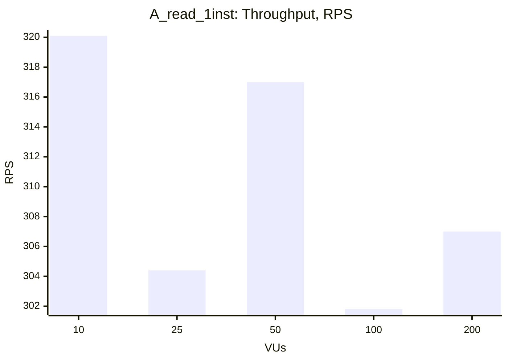
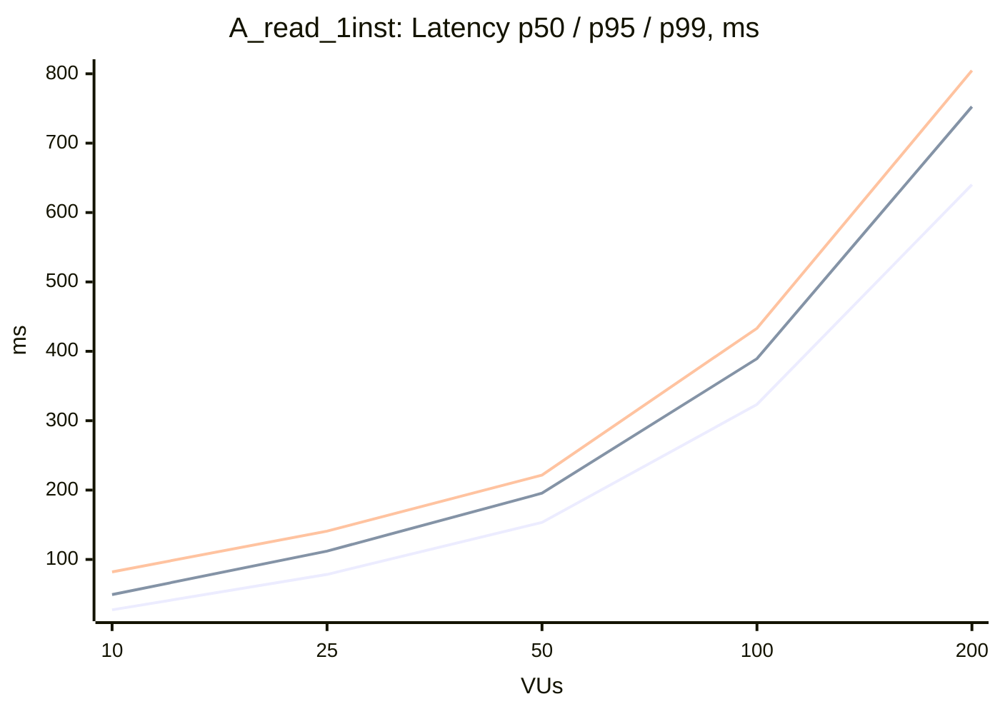

### A_read_1inst

| VUs | Throughput (RPS) | Avg, ms | p50, ms | p95, ms | p99, ms | Error Rate, % |
|---|---|---|---|---|---|---|
| 10 | 320.1 | 31.1 | 27.4 | 49.4 | 82.1 | 0.00 |
| 25 | 304.4 | 81.9 | 78.4 | 112.0 | 140.8 | 0.00 |
| 50 | 317.0 | 157.2 | 153.4 | 195.5 | 221.6 | 0.00 |
| 100 | 301.8 | 329.4 | 323.4 | 389.4 | 433.2 | 0.00 |
| 200 | 307.0 | 644.2 | 640.2 | 752.6 | 804.6 | 0.00 |

