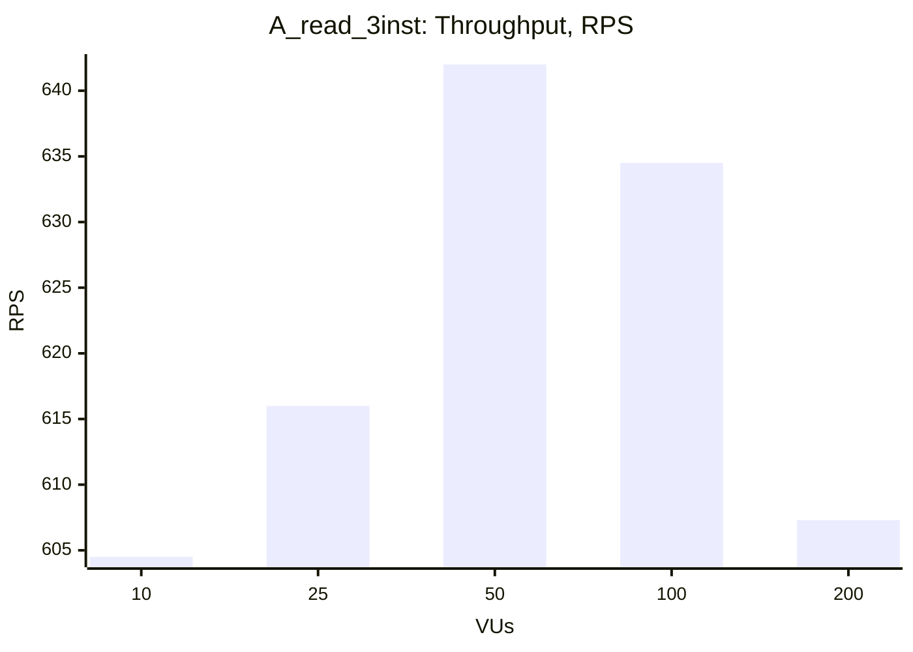
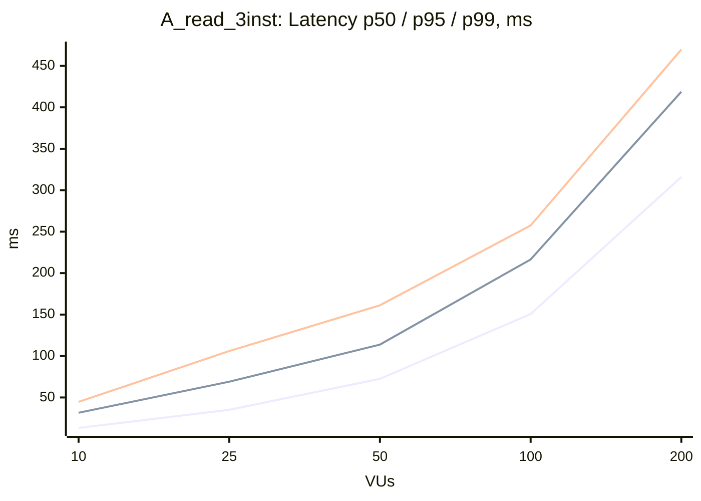

### A_read_3inst

| VUs | Throughput (RPS) | Avg, ms | p50, ms | p95, ms | p99, ms | Error Rate, % |
|---|---|---|---|---|---|---|
| 10 | 604.5 | 16.3 | 13.3 | 31.6 | 44.7 | 0.00 |
| 25 | 616.0 | 40.3 | 35.1 | 69.0 | 106.0 | 0.00 |
| 50 | 642.0 | 77.6 | 72.5 | 113.8 | 161.2 | 0.00 |
| 100 | 634.5 | 156.9 | 150.6 | 216.5 | 257.5 | 0.00 |
| 200 | 607.3 | 326.8 | 316.0 | 418.8 | 469.7 | 0.00 |

