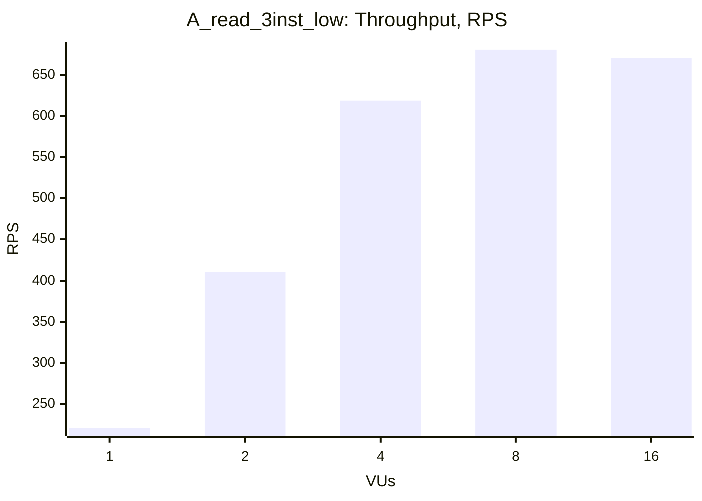
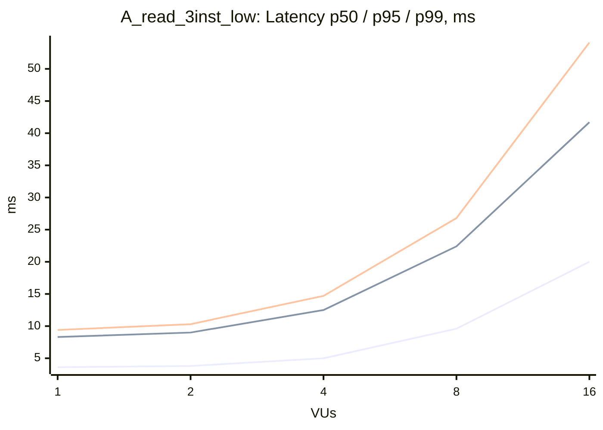

### A_read_3inst_low

| VUs | Throughput (RPS) | Avg, ms | p50, ms | p95, ms | p99, ms | Error Rate, % |
|---|---|---|---|---|---|---|
| 1 | 221.1 | 4.4 | 3.6 | 8.3 | 9.4 | 0.00 |
| 2 | 411.1 | 4.7 | 3.8 | 9.0 | 10.3 | 0.00 |
| 4 | 618.8 | 6.3 | 5.0 | 12.5 | 14.7 | 0.00 |
| 8 | 680.8 | 11.6 | 9.6 | 22.4 | 26.8 | 0.00 |
| 16 | 670.4 | 23.7 | 20.0 | 41.7 | 54.1 | 0.00 |

