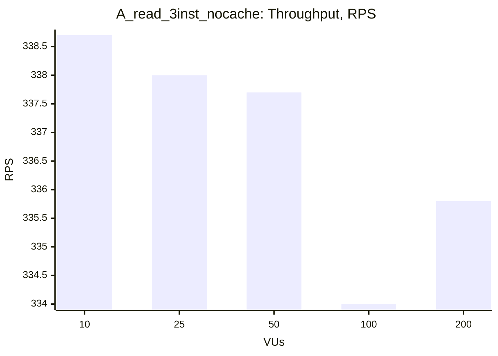
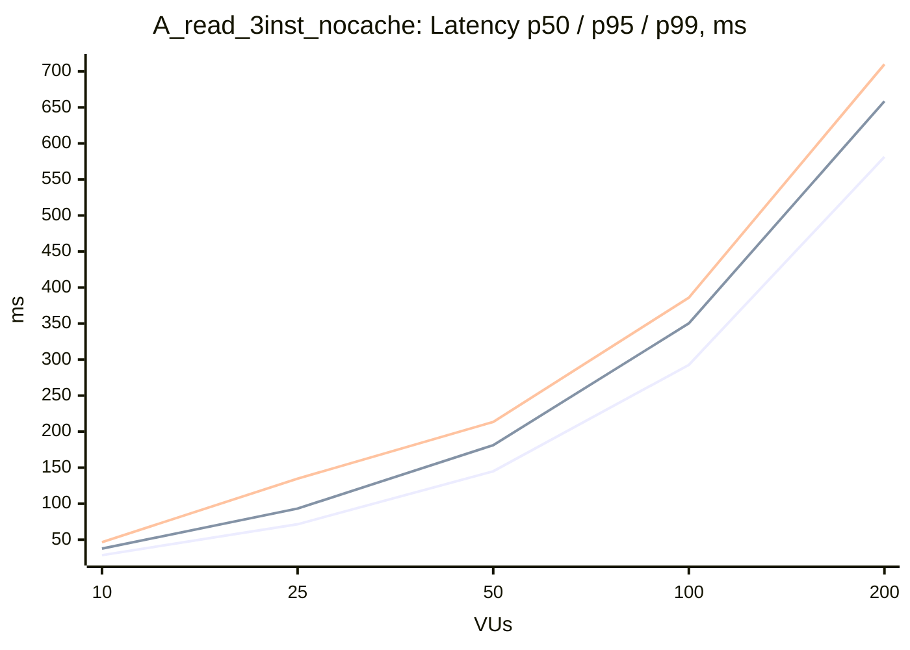

### A_read_3inst_nocache

| VUs | Throughput (RPS) | Avg, ms | p50, ms | p95, ms | p99, ms | Error Rate, % |
|---|---|---|---|---|---|---|
| 10 | 338.7 | 29.3 | 28.5 | 37.6 | 46.6 | 0.00 |
| 25 | 338.0 | 73.7 | 71.4 | 93.2 | 134.7 | 0.00 |
| 50 | 337.7 | 147.5 | 144.9 | 181.2 | 213.5 | 0.00 |
| 100 | 334.0 | 297.6 | 292.6 | 350.2 | 385.9 | 0.00 |
| 200 | 335.8 | 589.2 | 581.4 | 658.6 | 709.9 | 0.00 |

