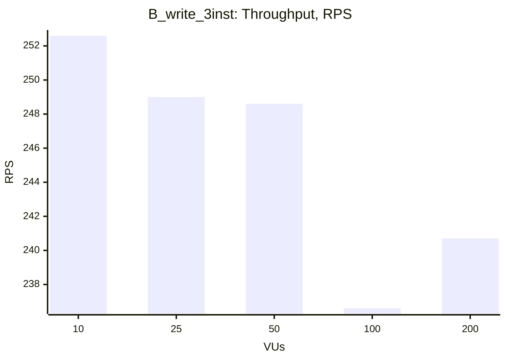
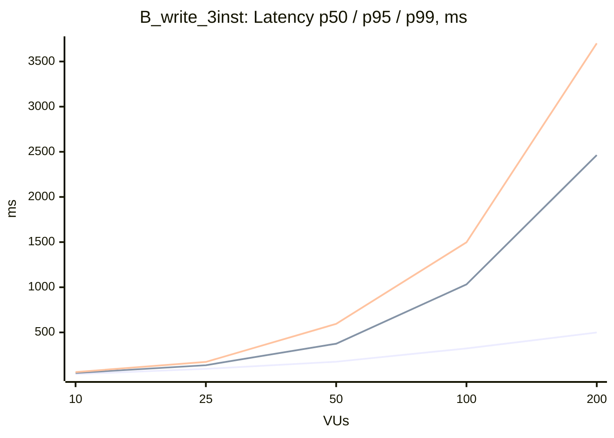

### B_write_3inst

| VUs | Throughput (RPS) | Avg, ms | p50, ms | p95, ms | p99, ms | Error Rate, % |
|---|---|---|---|---|---|---|
| 10 | 252.6 | 39.3 | 38.3 | 50.9 | 60.8 | 0.00 |
| 25 | 249.0 | 100.0 | 96.4 | 136.6 | 173.2 | 0.00 |
| 50 | 248.6 | 200.1 | 175.4 | 374.9 | 594.7 | 0.00 |
| 100 | 236.6 | 417.1 | 322.9 | 1031.6 | 1497.5 | 0.00 |
| 200 | 240.7 | 807.2 | 499.0 | 2463.8 | 3701.6 | 0.00 |

