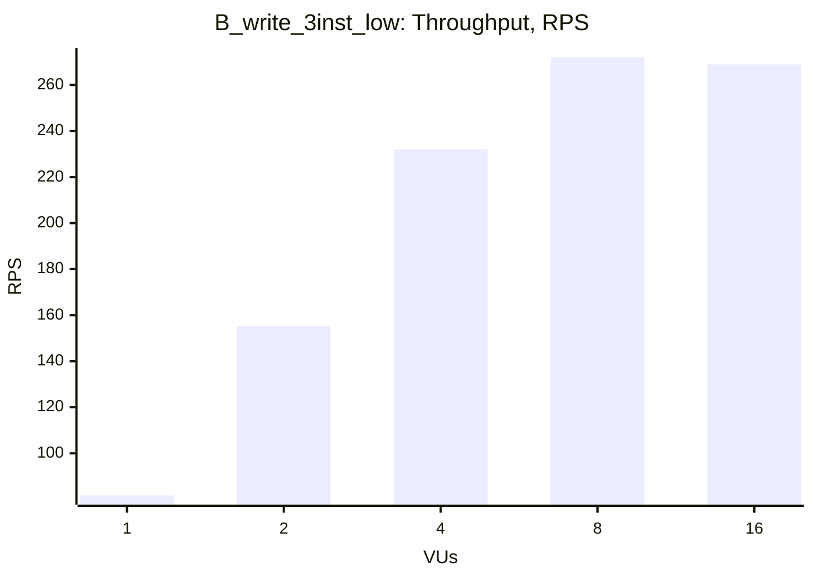
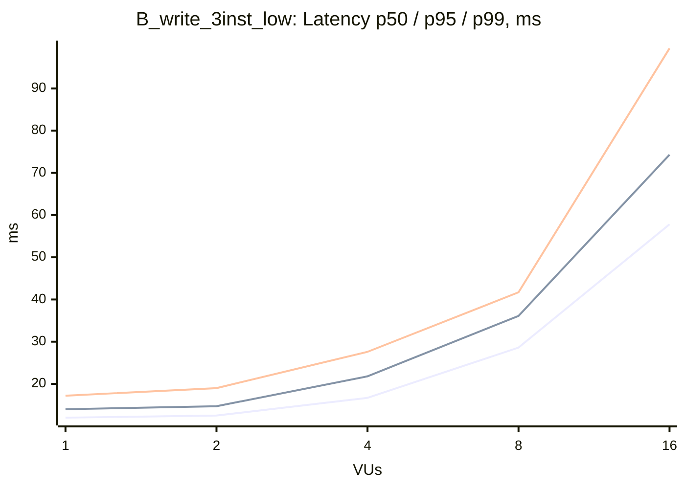

### B_write_3inst_low

| VUs | Throughput (RPS) | Avg, ms | p50, ms | p95, ms | p99, ms | Error Rate, % |
|---|---|---|---|---|---|---|
| 1 | 81.7 | 12.1 | 12.0 | 14.0 | 17.2 | 0.00 |
| 2 | 155.3 | 12.7 | 12.5 | 14.7 | 19.0 | 0.00 |
| 4 | 232.1 | 17.0 | 16.7 | 21.8 | 27.6 | 0.00 |
| 8 | 272.0 | 29.2 | 28.6 | 36.1 | 41.7 | 0.00 |
| 16 | 268.9 | 59.2 | 57.8 | 74.3 | 99.5 | 0.00 |

