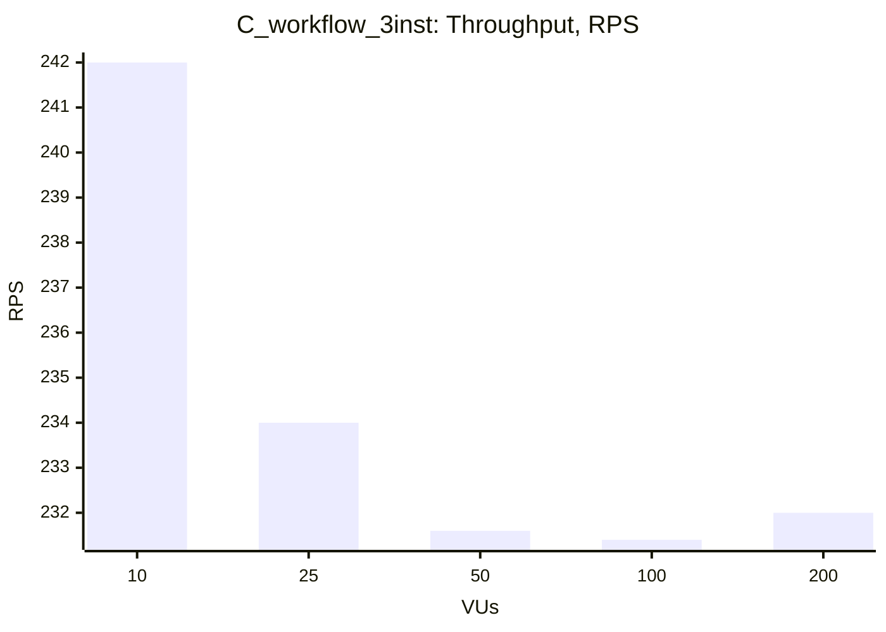
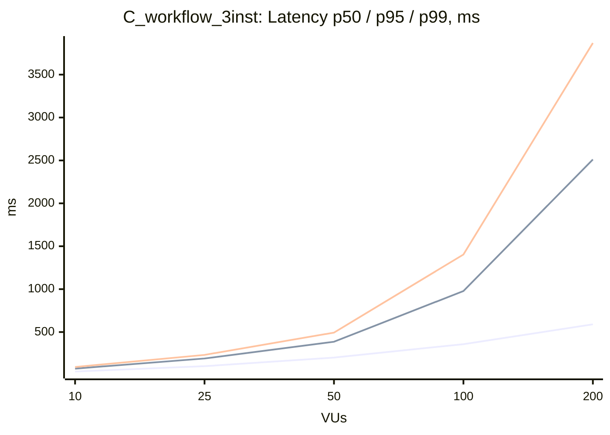

### C_workflow_3inst

| VUs | Throughput (RPS) | Avg, ms | p50, ms | p95, ms | p99, ms | Error Rate, % |
|---|---|---|---|---|---|---|
| 10 | 242.0 | 41.1 | 39.8 | 73.8 | 92.6 | 0.00 |
| 25 | 234.0 | 106.5 | 102.2 | 191.8 | 233.8 | 0.00 |
| 50 | 231.6 | 214.9 | 202.3 | 386.7 | 493.4 | 0.00 |
| 100 | 231.4 | 427.4 | 358.7 | 977.9 | 1403.5 | 0.00 |
| 200 | 232.0 | 835.0 | 589.9 | 2511.2 | 3868.5 | 0.00 |

