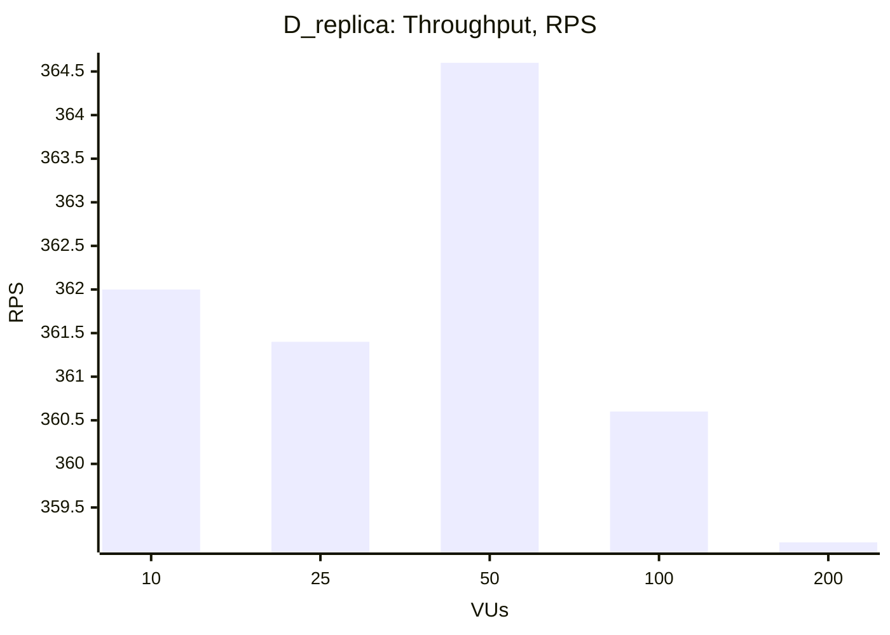
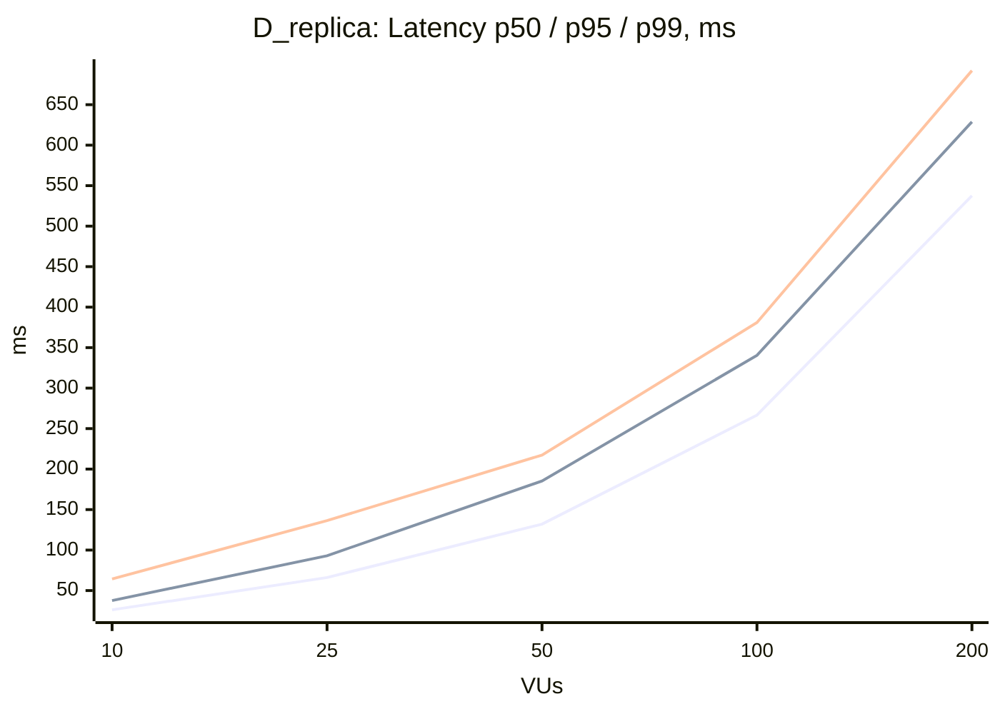

### D_replica

| VUs | Throughput (RPS) | Avg, ms | p50, ms | p95, ms | p99, ms | Error Rate, % |
|---|---|---|---|---|---|---|
| 10 | 362.0 | 27.4 | 26.2 | 37.6 | 64.3 | 0.00 |
| 25 | 361.4 | 68.8 | 66.1 | 93.0 | 136.4 | 0.00 |
| 50 | 364.6 | 136.4 | 132.0 | 185.3 | 217.3 | 0.00 |
| 100 | 360.6 | 274.7 | 266.6 | 340.5 | 381.0 | 0.00 |
| 200 | 359.1 | 547.6 | 537.6 | 628.8 | 692.1 | 0.00 |

