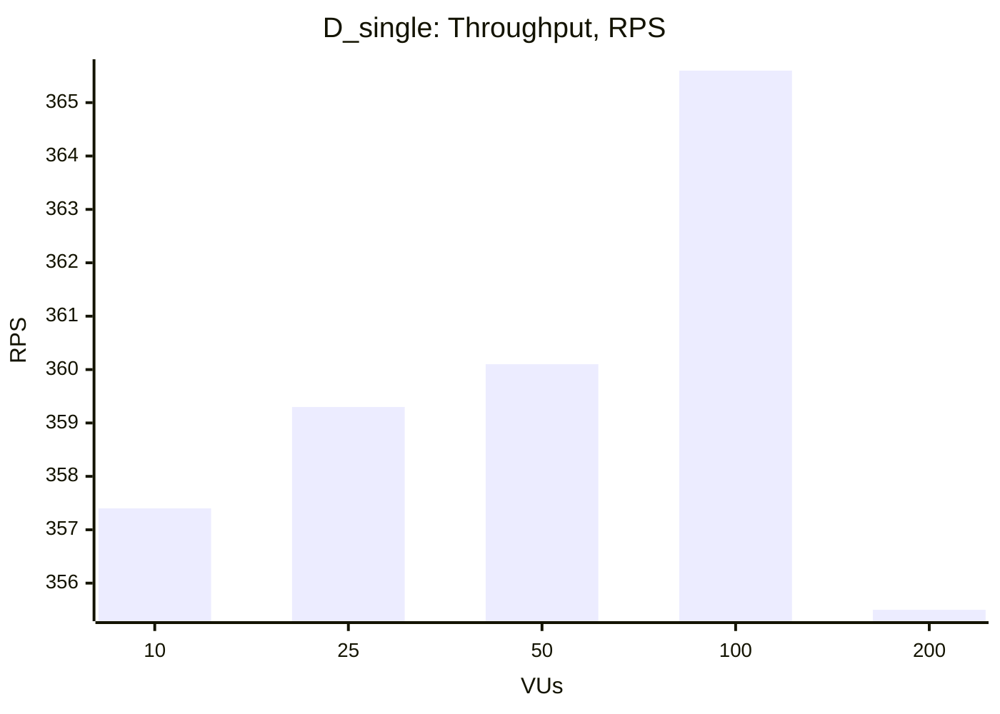
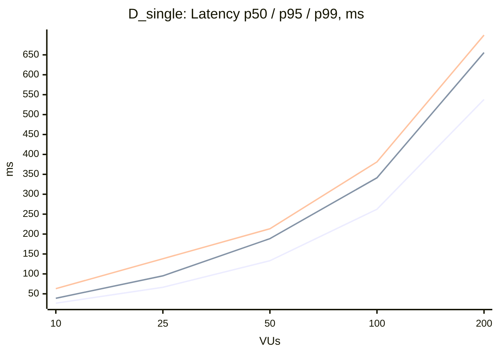

### D_single

| VUs | Throughput (RPS) | Avg, ms | p50, ms | p95, ms | p99, ms | Error Rate, % |
|---|---|---|---|---|---|---|
| 10 | 357.4 | 27.8 | 26.4 | 38.8 | 62.9 | 0.00 |
| 25 | 359.3 | 69.3 | 66.4 | 95.1 | 138.1 | 0.00 |
| 50 | 360.1 | 138.1 | 133.1 | 188.5 | 213.4 | 0.00 |
| 100 | 365.6 | 271.2 | 262.3 | 341.3 | 381.2 | 0.00 |
| 200 | 355.5 | 553.7 | 538.1 | 655.7 | 699.6 | 0.00 |

